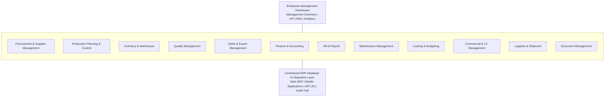
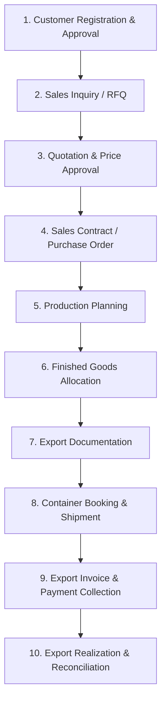
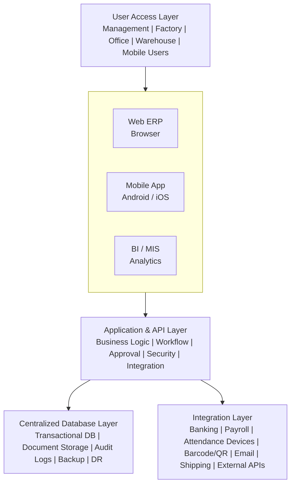
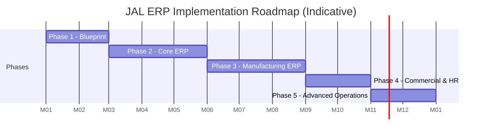

# ERP Overview for Jute Alliance Limited (JAL)

**Proposed Enterprise Resource Planning (ERP) Strategy & Functional Architecture**

---

## Table of Contents

1. [Business Overview and ERP Objectives](#1-business-overview-and-erp-objectives)
2. [Proposed ERP Functional Modules](#2-proposed-erp-functional-modules)
3. [Product-wise ERP Master Data Design](#3-product-wise-erp-master-data-design)
4. [Critical Manufacturing and Inventory Design](#4-critical-manufacturing-and-inventory-design)
5. [Management Dashboard and MIS Reports](#5-management-dashboard-and-mis-reports)
6. [Recommended Technical Architecture](#6-recommended-technical-architecture)
7. [Recommended ERP Implementation Phases](#7-recommended-erp-implementation-phases)
8. [Critical Business Questions Before ERP Development](#8-critical-business-questions-before-erp-development)
9. [Key Recommendations for JAL](#9-key-recommendations-for-jal)
10. [Final Proposed ERP Scope](#10-final-proposed-erp-scope)
11. [Recommended Next Deliverable](#11-recommended-next-deliverable)

---

## 1. Business Overview and ERP Objectives

Jute Alliance Limited (JAL) is a joint venture between **Samuda Chemical Complex Ltd.** and **Bay Group**, established in February 2022. The company operates as a fully export-oriented jute manufacturing enterprise, with operations overseen by Samuda Chemical Complex Ltd.

| Business indicator | Information |
|---|---|
| Business type | Export-oriented jute manufacturing |
| Establishment | February 2022 |
| Workforce | Approximately 2,800 |
| Production floor | 300,000 sq. ft. |
| Management professionals | 100+ |
| First-year export proceeds | US$15 million |
| Business tagline | *Reclaiming the Heritage* |

### Primary ERP Objectives

The proposed ERP should provide an integrated platform to manage the entire business lifecycle:

1. Raw jute procurement and supplier management.
2. Jute processing, manufacturing and production planning.
3. Yarn, fabric, sacking bag and other product manufacturing.
4. Quality control at every production stage.
5. Inventory and warehouse management.
6. Export sales, shipment and commercial operations.
7. Financial accounting and management reporting.
8. Human resource management and payroll for approximately 2,800 employees.
9. Costing, profitability and production efficiency analysis.
10. Centralized management reporting for JAL and its overseeing management.

> **Recommendation:** JAL should implement a **manufacturing-centric ERP** rather than a conventional trading or accounting-oriented ERP. Production planning, process manufacturing, inventory traceability, export management and product costing should be the core of the system.

---

## 2. Proposed ERP Functional Modules

The ERP is divided into **12 major functional areas**.

### 2.1 Procurement and Supplier Management

Manages the complete raw material procurement lifecycle.

**Key functionalities:**

- Supplier registration and approval
- Raw jute supplier classification
- Purchase requisition
- Request for quotation (RFQ)
- Comparative statement
- Purchase order (PO)
- Goods receiving note (GRN)
- Supplier bills and payment
- Purchase return
- Supplier performance evaluation

**JAL-specific requirement:** Raw jute procurement should support **quality-based purchasing**. Different grades of jute may have different prices, moisture levels, fibre characteristics and processing suitability.

The system should record:

- Jute variety and grade
- Supplier and purchase location
- Gross, tare and net weight
- Moisture percentage
- Quality assessment
- Purchase rate per applicable unit
- Rejection and deduction details

### 2.2 Production Planning and Manufacturing ⭐ *Most critical module*

JAL manufactures sacking bags, hessian cloth, jute yarn, geo jute soil saver and jute sliver. The ERP must therefore support **multi-stage, process-based manufacturing**.

**Proposed manufacturing stages:**

| # | Production stage | Activities |
|---|---|---|
| 1 | Raw material preparation | Selection, batching and softening |
| 2 | Carding | Fibre opening and carding |
| 3 | Drawing | Fibre alignment and drawing |
| 4 | Spinning | Jute yarn production |
| 5 | Winding | Yarn winding and preparation |
| 6 | Weaving | Hessian and sacking cloth production |
| 7 | Cutting | Fabric cutting according to bag size |
| 8 | Sewing | Bag stitching and finishing |
| 9 | Inspection | Quality inspection and rejection |
| 10 | Packing | Bale preparation and identification |
| 11 | Finished goods | Warehouse transfer |

> The exact routing should be validated against JAL's actual factory machinery and manufacturing processes.

**Key functionalities:**

- Production planning
- Production orders
- Bill of Materials (BOM)
- Routing and work centers
- Machine-wise production planning
- Shift-wise production
- Production requisition
- Raw material consumption
- Semi-finished goods tracking
- Production reporting
- Waste and wastage management
- Rework and rejection
- Finished goods receipt

### 2.3 Product Master and Specification Management

JAL has 17 listed product entries, although *Sugar Twills Sacking Bag* appears twice. These should be consolidated into unique product masters with controlled technical specifications. The ERP should support **product variants** and **specification-based production orders**.

**Example — Standard B' Twill Sacking Jute Bag**

| Specification | Value |
|---|---|
| Bag size | 44" × 26.5" |
| Bag weight | 1,020 grams |
| Porter & Shots | 6 × 8 |
| Stitching | Hemmed mouth and side Herackle sewn |
| Stripe | 3 blue stripes |
| Bags per bale | 300 |
| Bales per 20' FCL | 65 |
| Bags per container | 19,500 |

Each product master should contain:

- Product code and description
- Product category
- Product dimensions
- GSM or weight specification, as applicable
- Yarn count
- Porter and shots
- Stripe colour and design
- Stitching specification
- Packing specification
- Standard production routing
- Quality parameters
- Export specification

> The system should allow customers to order customized products **without creating duplicate product masters** for every specification variation.

### 2.4 Inventory and Warehouse Management

Inventory is particularly important because JAL has multiple production stages and different types of raw materials, work-in-progress and finished goods.

**Inventory categories:**

| Category | Examples |
|---|---|
| Raw materials | Raw jute, fibre, chemicals, batching oil |
| Semi-finished goods | Jute sliver, roving, yarn, woven cloth |
| Finished goods | Sacking bags, hessian cloth, yarn, soil saver |
| Packaging materials | Iron wire, bale materials, labels |
| Spare parts | Machine parts, bearings, belts |
| Consumables | Lubricants, cleaning materials, production supplies |

**Warehouse structure:**

- Raw Jute Warehouse
- Raw Material Warehouse
- Production Stores
- Yarn Warehouse
- Fabric Warehouse
- Finished Goods Warehouse
- Packaging Warehouse
- Spare Parts Warehouse
- Export Dispatch Warehouse

**Essential functionalities:**

- Multiple warehouses and locations
- Bin/rack management
- Batch and lot tracking
- FIFO/FEFO where applicable
- Stock transfer
- Material issue and return
- Physical stock verification
- Stock adjustment with approval
- Minimum and maximum stock levels
- Stock aging
- Real-time stock valuation
- Material traceability

> **Important:** The ERP should track raw material consumption against production orders and calculate actual production **yield, wastage and material variance**.

### 2.5 Quality Management (QMS)

Quality management should be integrated with procurement, manufacturing and finished goods.

| Stage | Quality inspection parameters |
|---|---|
| Raw jute | Moisture, grade, fibre quality, colour |
| Yarn | Count, strength, uniformity |
| Fabric | Width, weight, weave density, defects |
| Sacking bags | Dimensions, weight, stitching, stripes |
| Hessian cloth | Width, OZ, porter and shots |
| Soil saver | Width, weight, mesh specification |
| Finished goods | Customer specification and packing |

**Functionalities:**

- Quality inspection plans
- Inspection checklists
- Quality acceptance/rejection
- Quality hold and release
- Non-conformance reporting
- Corrective and preventive action (CAPA)
- Supplier quality rating
- Customer complaint management

> The ERP should **prevent rejected or quality-hold materials from being dispatched** without authorized release.

### 2.6 Sales and Export Management

As JAL is a fully export-oriented organization, export sales are a **core business module**.

**Sales process:**

**Export functionalities:**

- International customer management
- Country-wise sales
- Product-wise export pricing
- Quotation management
- Sales contracts
- Customer-specific product specifications
- Incoterms management (FOB, CFR, CIF, etc.)
- Currency management
- Export order tracking
- Shipment planning
- Container management
- Packing list generation
- Commercial invoice
- Proforma invoice
- Certificate of Origin documentation
- Bill of Lading tracking
- EXP form and export realization tracking
- Export receivable management

> The system should also provide **order-wise profitability** and **shipment-wise costing**.

### 2.7 Commercial and Letter of Credit (LC) Management

For export-oriented manufacturing, commercial operations should be integrated with sales, procurement and finance.

**Key functionalities:**

- Export LC registration
- LC amendment
- LC expiry tracking
- LC value and currency
- Back-to-back LC management, if applicable
- Import LC management
- Import documents
- Shipping documents
- Insurance and freight expenses
- Customs and clearing expenses
- Bank charges
- Export proceeds realization
- LC-wise outstanding liability

> The ERP should provide an **LC-wise financial position and document tracking dashboard**.

### 2.8 Finance and Accounting

| Functional area | Major activities |
|---|---|
| General Ledger | Chart of Accounts, vouchers, journals |
| Accounts Payable | Supplier bills and payments |
| Accounts Receivable | Customer invoices and collections |
| Cash & Bank | Bank transactions and reconciliation |
| Fixed Assets | Asset register and depreciation |
| Cost Accounting | Product and process costing |
| Budgeting | Department-wise and cost-center budgets |
| Tax & VAT | Applicable tax and VAT accounting |
| Foreign Currency | Multi-currency transactions and revaluation |
| Financial Reporting | Balance Sheet, P&L and Cash Flow |

**Special requirement — multi-dimensional financial reporting:**

- Company-wise
- Department-wise
- Factory-wise
- Production line-wise
- Cost center-wise
- Product-wise
- Customer-wise
- Export order-wise
- Shipment-wise

This is particularly useful for management oversight by Samuda Chemical Complex Ltd.

### 2.9 HR and Payroll Management

With approximately 2,800 employees, HR and payroll must support both factory workers and management employees.

**Employee categories:**

- Permanent employees
- Contractual employees
- Daily labour
- Production workers
- Supervisors
- Management staff
- Administrative staff

**Functionalities:**

- Employee information management
- Organizational hierarchy
- Recruitment and onboarding
- Employee attendance
- Shift and roster management
- Leave management
- Overtime management
- Payroll processing
- Salary and wage calculation
- Bonus and allowances
- Loan and advance management
- Provident fund and gratuity, where applicable
- Employee performance management
- Training management
- Final settlement

> **Factory requirement:** Shift-based attendance, overtime, production worker wage calculation and payroll integration must be supported.

### 2.10 Plant Maintenance Management (CMMS)

Jute manufacturing depends heavily on machinery. Unplanned machine downtime directly affects production capacity and delivery commitments. The ERP should include an integrated **Computerized Maintenance Management System (CMMS)**.

- Machine and equipment register
- Machine location and department
- Preventive maintenance schedules
- Breakdown maintenance
- Corrective maintenance
- Maintenance work orders
- Spare parts consumption
- Maintenance cost tracking
- Equipment downtime
- Machine efficiency
- Maintenance history
- Maintenance KPI

**Suggested KPIs:**

- **MTBF** – Mean Time Between Failures
- **MTTR** – Mean Time To Repair
- Machine availability
- Planned vs. unplanned downtime
- Maintenance cost per production unit

### 2.11 Costing and Budgeting

One of the most important requirements for JAL's management. The ERP should calculate **actual manufacturing costs** instead of relying only on standard product costs.

**Product cost components:**

$$
\text{Product Cost} = \text{Raw Materials} + \text{Labour} + \text{Power} + \text{Overhead} + \text{Packaging}
$$

**Additional costs:**

- Factory overhead
- Machine depreciation
- Maintenance expenses
- Production wastage
- Quality rejection
- Freight and shipment expenses
- Export documentation and bank charges

**The system should calculate:**

1. Standard production cost
2. Actual production cost
3. Cost per kilogram
4. Cost per bag
5. Cost per bale
6. Cost per yard
7. Cost per roll
8. Cost per export container
9. Product-wise gross profit
10. Order-wise and customer-wise profitability

### 2.12 Document Management and Approval Workflow

JAL should have centralized document management covering:

- Purchase requisitions
- Purchase orders
- Supplier quotations
- Production orders
- Quality inspection reports
- Sales contracts
- Export documents
- LC documents
- Bank documents
- HR documents
- Maintenance reports

> Approval workflows should be configurable by **department, designation, amount and transaction type**.

---

## 3. Product-wise ERP Master Data Design

Recommended product categorization based on the 17 provided entries:

| Product category | Products |
|---|---|
| Sacking Bags | Standard B' Twill, Standard Binola, Light Cees, Cut Size Binola, Heavy Cees, Sugar Twills |
| Hessian Cloth | 40-inch and 45-inch Hessian |
| Sand Bags | Hessian sand bags, laminated and unlaminated |
| Geo Products | Geo Jute Soil Saver |
| Jute Yarn | Sacking Yarn, White Jute Yarn, Jute Yarn/Twine |
| Yarn Cops | 28/1 Jute Yarn Cops |
| Semi-finished Products | Jute Sliver Roll |

### Recommended Product Master Structure

Rather than storing all product details in a single description field, use **structured attributes**.

| Attribute | Example |
|---|---|
| Product Code | JAL-SB-001 |
| Product Category | Sacking Bag |
| Product Name | Standard B' Twill |
| Length | 44 inches |
| Width | 26.5 inches |
| Weight | 1,020 grams |
| Yarn Specification | 6 × 8 |
| Stripe Colour | Blue |
| Stripe Quantity | 3 |
| Stitching Type | Herackle Sewn |
| Bags per Bale | 300 |
| Bale per Container | 65 |
| Base UOM | Pcs |

> **Design consideration:** Maintain **product specification revisions with effective dates**. This helps when customers change bag dimensions, weight, yarn specifications or packing requirements.

---

## 4. Critical Manufacturing and Inventory Design

One of the most important decisions is how to manage the different **units of measurement (UOM)**.

| Product | Primary UOM | Secondary UOM |
|---|---|---|
| Sacking Bags | Pcs | Bale, Container |
| Hessian Cloth | Yard | Bale, Roll |
| Sand Bags | Pcs | Bale |
| Geo Jute Soil Saver | Roll | Yard, Container |
| Jute Yarn | Kg / LBS | Roll |
| Yarn Cops | Pcs | Kg |
| Jute Sliver | Kg | Roll |

The ERP must support **multiple UOM conversions**.

**Example — Standard B' Twill Sacking Bag packing calculation:**

| Bags per bale | Bales per container | Total export quantity per 20' FCL |
|---|---|---|
| 300 | 65 | **19,500 bags** |

$$
300 \times 65 = 19{,}500
$$

For every product, the ERP should calculate:

- Production quantity
- Bale quantity
- Container loading quantity
- Net weight
- Gross weight
- Shipment quantity
- Packing material consumption

It should also support **partial bale and partial container shipments**, subject to customer and shipping requirements.

---

## 5. Management Dashboard and MIS Reports

JAL's ERP should have separate dashboards for the **Board/Management, CEO, CFO, Factory Head, Production Head, Commercial Head, HR Head** and departmental managers.

### Executive Dashboard (Illustrative)

*Suggested dashboard indicators; these are not actual company figures.*

| Indicator | Value |
|---|---|
| Employee strength | 2,800 |
| Production floor (sq. ft.) | 300K |
| Production monitoring | Daily |
| Inventory monitoring | Real-time |

### Recommended Management KPIs

- Daily production vs. target
- Production efficiency
- Raw material consumption
- Wastage percentage
- Machine downtime
- Finished goods stock
- Export order fulfillment
- Container utilization
- Export proceeds
- Product-wise profitability
- Employee attendance
- Cash flow and working capital

### Essential MIS Reports

| Department | Reports |
|---|---|
| Procurement | Purchase summary, supplier performance, purchase price variance |
| Inventory | Stock ledger, aging, stock valuation, batch traceability |
| Production | Daily production, shift-wise output, yield, wastage |
| Quality | Inspection, rejection, defect analysis |
| Sales | Order book, customer-wise sales, pending orders |
| Export | Shipment status, LC status, export realization |
| Finance | Trial Balance, P&L, Balance Sheet, Cash Flow |
| HR | Attendance, overtime, payroll, manpower |
| Maintenance | Breakdown, downtime, MTBF, MTTR |
| Costing | Product cost, order profitability, cost variance |

---

## 6. Recommended Technical Architecture

A **centralized, web-based ERP** with mobile applications for factory operations and management.

### Suggested Technology Stack

| Layer | Recommended technology |
|---|---|
| Frontend | React.js / Next.js |
| Backend | Node.js + TypeScript |
| Architecture | Modular Monolith |
| Database | PostgreSQL |
| Mobile | React Native |
| API | REST API |
| Reporting | Power BI / Metabase |
| Cache | Redis |
| Background Jobs | BullMQ |
| File Storage | S3-compatible storage |
| Authentication | RBAC + MFA |
| Deployment | VMware / Private Cloud / Hybrid Cloud |
| Monitoring | Grafana + Prometheus |

> **Architecture choice:** Start with a **modular monolith** instead of microservices. This simplifies development, deployment, transaction management and maintenance. Individual modules can be separated later if business requirements justify it.

> For a manufacturing operation, evaluate whether production machines can provide real-time machine data through **PLC/SCADA integration**.

---

## 7. Recommended ERP Implementation Phases

Implementing all modules simultaneously is not recommended. A **phased implementation** reduces operational risk.

| Phase | Timeline | Scope |
|---|---|---|
| **Phase 1 – Business Analysis & ERP Blueprint** | Month 1–2 | Business process analysis; factory process mapping; product master preparation; Chart of Accounts; ERP requirement documentation; infrastructure assessment |
| **Phase 2 – Core ERP Implementation** | Month 3–5 | Finance & Accounting; Procurement; Inventory; Sales; supplier and customer management; approval workflows |
| **Phase 3 – Manufacturing ERP** | Month 6–8 | Production planning; BOM and routing; work centers; production reporting; Quality management; product costing |
| **Phase 4 – Commercial & HR** | Month 9–10 | Export management; LC management; shipment management; HR & Payroll; attendance integration |
| **Phase 5 – Advanced Operations** | Month 11–12 | Maintenance management; Barcode/QR; mobile applications; BI dashboards; advanced analytics; DR and business continuity testing |

**Estimated implementation duration: 12 months**

*Indicative planning estimate. Actual duration depends on process complexity, customization, data migration and user readiness.*

---

## 8. Critical Business Questions Before ERP Development

These should be resolved before finalizing the SRS and database architecture.

| Area | Questions to resolve |
|---|---|
| Organization | Is JAL operating as one legal entity or multiple entities? |
| Manufacturing | Are all production processes performed in-house? |
| Raw materials | How many grades and categories of raw jute are purchased? |
| Production | Does production follow Make-to-Stock, Make-to-Order or both? |
| Product | Are product specifications customer-specific? |
| Costing | Is costing required by product, production batch or export order? |
| Inventory | How many factories and warehouses are operational? |
| Export | Which countries and currencies are involved? |
| Commercial | Are import LCs and back-to-back LCs applicable? |
| HR | Are factory workers paid monthly, daily or on a production basis? |
| Management | Does Samuda require consolidated management reporting? |
| Infrastructure | Will ERP be deployed on-premises, private cloud or public cloud? |

---

## 9. Key Recommendations for JAL

Special attention should be given to these seven areas during ERP design:

1. **Production traceability** — Trace raw jute from procurement through fibre, yarn, fabric and finished products.
2. **Actual production costing** — Determine the actual manufacturing cost of every product and export order.
3. **Wastage management** — Monitor material loss and production yield at every manufacturing stage.
4. **Export integration** — Connect customer orders, production, inventory, shipment and export realization.
5. **Multi-UOM inventory** — Handle KG, LBS, Pcs, Bale, Yard, Roll and Container without inconsistent stock records.
6. **Machine maintenance** — Integrate preventive maintenance, breakdown tracking and production downtime.
7. **Management visibility** — Provide Samuda's management with consolidated financial, production and operational performance reports.

---

## 10. Final Proposed ERP Scope

| Priority | Module | Implementation priority |
|---|---|---|
| 🔴 Critical | Finance & Accounting | Phase 1 |
| 🔴 Critical | Procurement | Phase 1 |
| 🔴 Critical | Inventory & Warehouse | Phase 1 |
| 🔴 Critical | Production Planning & Manufacturing | Phase 2 |
| 🔴 Critical | Quality Management | Phase 2 |
| 🟠 High | Sales & Export Management | Phase 1–2 |
| 🟠 High | Product Costing | Phase 2 |
| 🟠 High | Commercial & LC Management | Phase 3 |
| 🟠 High | HR & Payroll | Phase 3 |
| 🟠 High | Maintenance Management | Phase 3 |
| 🟡 Medium | Mobile Applications | Phase 4 |
| 🟡 Medium | BI & Advanced Analytics | Phase 4 |

> **Overall recommendation:** JAL needs an integrated **Manufacturing ERP** with strong capabilities in process manufacturing, production control, quality management, multi-unit inventory, export operations and financial costing. The ERP should connect the factory floor with the commercial and financial departments, giving management a **single source of reliable business information**.

---

## 11. Recommended Next Deliverable

Prepare a complete **Jute Alliance Limited ERP Software Requirement Specification (SRS)** before selecting or developing the software.

The SRS should include:

- [ ] Complete functional requirements for all ERP modules
- [ ] Detailed manufacturing workflow and production routing
- [ ] Product master and specification database design
- [ ] BOM, routing and production costing methodology
- [ ] Inventory and warehouse database schema
- [ ] Export and LC management workflows
- [ ] HR and payroll requirements
- [ ] Role-based access and approval matrix
- [ ] UI/UX screen-by-screen design
- [ ] Technical architecture and database ERD
- [ ] Management dashboards and MIS reports
- [ ] Implementation roadmap and project estimation

The SRS can be prepared as a comprehensive, development-ready ERP blueprint for JAL, using **Node.js, TypeScript, PostgreSQL** and a **modular monolith** architecture.
