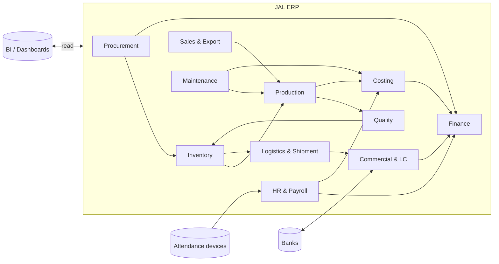

# JAL ERP — Software Requirements Specification (SRS)

## Part 0 — Introduction & Overall Description

| Item | Detail |
|---|---|
| Document | Software Requirements Specification — JAL Manufacturing ERP |
| Client | Jute Alliance Limited (JAL) — JV of Samuda Chemical Complex Ltd. & Bay Group |
| Version | 0.1 (Draft for review) |
| Date | 5 November 2026 |
| Status | Draft — pending answers to open business questions (see §0.9) |
| Source | [JAL_ERP_Overview.md](../JAL_ERP_Overview.md) |

### Document Map

| Part | File | Contents |
|---|---|---|
| 0 | [00_Introduction.md](00_Introduction.md) | Purpose, scope, glossary, users, assumptions, conventions |
| 1 | [01_FR_Supply_Manufacturing.md](01_FR_Supply_Manufacturing.md) | Functional requirements: Procurement, Product Master & UOM, Inventory, Production, Quality |
| 2 | [02_FR_Commercial_Finance_HR.md](02_FR_Commercial_Finance_HR.md) | Functional requirements: Sales & Export, Commercial/LC, Logistics, Finance, Costing, HR & Payroll, Maintenance, Documents & Workflow, Dashboards |
| 3 | [03_Data_Model.md](03_Data_Model.md) | Domain model, ERD, database schema conventions and core tables |
| 4 | [04_Security_Workflow_UI_Reports.md](04_Security_Workflow_UI_Reports.md) | Roles, RBAC, approval matrix, screen inventory, MIS report catalogue |
| 5 | [05_NFR_Architecture_Implementation.md](05_NFR_Architecture_Implementation.md) | Non-functional requirements, technical architecture, integrations, migration, testing, roadmap, estimation, risks |

---

## 0.1 Purpose

This SRS defines the functional and non-functional requirements of a manufacturing-centric ERP for Jute Alliance Limited. It is intended to be **development-ready**: each requirement is uniquely identified, prioritised and testable, so it can be used for build, vendor evaluation, UAT and change control.

**Intended readers:** JAL management and Samuda oversight team, department heads (process owners), the ERP development team, QA/UAT team, and IT infrastructure team.

## 0.2 Scope

The system ("JAL ERP") covers the full order-to-cash, procure-to-pay, plan-to-produce, hire-to-retire and record-to-report cycles of a single export-oriented jute manufacturing company, with consolidated reporting for the overseeing management.

**In scope**

- 12 functional modules: Procurement, Production Planning & Control, Inventory & Warehouse, Quality, Sales & Export, Finance & Accounting, HR & Payroll, Maintenance (CMMS), Costing & Budgeting, Commercial & LC, Logistics & Shipment, Document Management — plus the Enterprise Dashboard.
- Web application, mobile applications (shop floor, warehouse, approvals, management), REST API, BI layer.
- Integrations: banks, attendance devices, barcode/QR, email/SMS, shipping lines/forwarders (document level), BI tools.
- Data migration of masters and opening balances.

**Out of scope (this release)**

- Direct PLC/SCADA machine integration (feasibility study only — see §5 of Part 5).
- E-commerce / customer self-service portal.
- Statutory e-filing with government portals (export files will be generated; direct submission is a future enhancement).
- Multi-company consolidation of entities other than JAL (data model will be multi-company ready).

## 0.3 Glossary

| Term | Meaning |
|---|---|
| Hessian | Plain-woven jute cloth, sold by the yard/metre; specified by width (e.g. 40", 45") and weight (oz per sq. yd). |
| Sacking | Heavier, coarser jute cloth / bag, often twill-woven (e.g. B' Twill, Binola, Cees). |
| Porter | Count of warp ends per unit width (reed measure). Expressed with shots, e.g. "6 × 8". |
| Shots | Count of weft picks per inch. |
| Herackle sewn | Overlock-type edge/side stitching used on jute bags. |
| Sliver | Continuous strand of carded/drawn fibre — intermediate before spinning. |
| Roving | Lightly twisted sliver (where applicable) prepared for spinning. |
| Cops | Yarn wound on a spindle/tube for weaving weft or sale (e.g. 28/1 cops). |
| Yarn count (lbs/spyndle) | Jute yarn count expressed as weight in lbs of 14,400 yards (one spyndle). |
| Batching | Applying batching oil/emulsion and water to raw jute to soften it before carding. |
| Bale (finished goods) | Pressed pack of bags/cloth, e.g. 300 bags per bale. |
| Bale (raw jute) | Pressed raw jute bale, traditionally 400 lb (≈181.4 kg). |
| Maund | Local trade unit for raw jute (1 maund ≈ 37.32 kg). Configurable UOM. |
| FCL | Full Container Load (20' / 40'). |
| Incoterms | International trade terms (FOB, CFR, CIF, etc.). |
| LC / B2B LC | Letter of Credit / Back-to-back Letter of Credit. |
| EXP | Export form required by Bangladesh Bank for export proceeds monitoring. |
| PRC | Proceeds Realisation Certificate issued by the bank. |
| GRN | Goods Receiving Note. |
| BOM | Bill of Materials. |
| WIP | Work in progress. |
| NCR / CAPA | Non-Conformance Report / Corrective and Preventive Action. |
| CMMS | Computerised Maintenance Management System. |
| MTBF / MTTR | Mean Time Between Failures / Mean Time To Repair. |
| RBAC | Role-Based Access Control. |
| Mushak | Bangladesh VAT forms prescribed under VAT & SD Act 2012. |

## 0.4 Product Perspective

JAL ERP is a new, self-contained system replacing spreadsheets and any stand-alone accounting/payroll tools currently used. It is built as a **modular monolith** (Node.js + TypeScript, PostgreSQL) with a shared database, a single deployable backend, and clearly separated module boundaries (see Part 5).

## 0.5 User Classes

| User class | Approx. users | Primary interface | Key needs |
|---|---|---|---|
| Board / Samuda oversight | 5–10 | Web, mobile dashboard | Consolidated KPIs, financials, drill-down |
| Senior management (CEO, CFO, Factory Head) | 10–15 | Web, mobile | Dashboards, approvals, exception alerts |
| Department heads & managers | 40–60 | Web | Transactions, approvals, departmental MIS |
| Officers / executives (office) | 80–120 | Web | Data entry, documents, reports |
| Floor supervisors / line in-charges | 60–100 | Tablet / mobile | Shift production entry, wastage, downtime |
| Storekeepers / warehouse staff | 20–30 | Web + handheld scanner | GRN, issue, transfer, stock count |
| QC inspectors | 15–25 | Tablet | Inspection checklists, hold/release |
| Maintenance technicians | 20–40 | Mobile | Work orders, spare consumption |
| Workers (~2,600) | — | Kiosk / mobile (read-only) | Payslip, leave balance, attendance (Phase 5) |

**Concurrency assumption:** up to 400 named users, 150 concurrent at peak (shift change, month-end payroll).

## 0.6 Operating Environment

- Modern browsers (Chrome, Edge, Firefox — last 2 versions); minimum 1366×768 screen.
- Android 10+ and iOS 15+ for mobile apps; rugged Android handhelds for warehouse scanning.
- Server: Linux on VMware / private cloud / hybrid (decision pending, Q-12).
- Factory network: wired + Wi-Fi coverage on production floor and warehouses; mobile apps must tolerate intermittent connectivity (offline queue).

## 0.7 Design and Implementation Constraints

| ID | Constraint |
|---|---|
| C-01 | Functional currency BDT; transactional currencies USD, EUR, GBP and others configurable. |
| C-02 | Financial year July–June (Bangladesh) by default; configurable. |
| C-03 | Compliance with Bangladesh VAT & SD Act 2012, Income Tax Act 2023 (withholding), Bangladesh Labour Act 2006 and Bangladesh Bank foreign-exchange regulations. Statutory rates must be **configurable, not hard-coded**. |
| C-04 | Accounting per IFRS as adopted in Bangladesh (IAS 2 inventory, IAS 16 PPE, IAS 21 FX). |
| C-05 | Every posted transaction is immutable; corrections via reversal documents only. |
| C-06 | Full audit trail on master data and transactions (who, what, when, before/after). |
| C-07 | English UI; Bangla labels for worker-facing screens and payslips (Phase 5). |
| C-08 | Technology stack per Part 5 (Next.js, Node.js/TypeScript, PostgreSQL, Redis, BullMQ, React Native). |

## 0.8 Assumptions and Dependencies

These assumptions are used in this draft until the open questions in §0.9 are answered. Each is tagged so it can be revisited.

| ID | Assumption |
|---|---|
| A-01 | JAL is a single legal entity with one factory site; the schema remains multi-company and multi-factory ready. |
| A-02 | All processes from batching to packing are in-house; outsourced job work (e.g. lamination of sand bags) is supported as subcontracting. |
| A-03 | Production is **both** Make-to-Order (customer-specific bags) and Make-to-Stock (standard yarn, hessian). |
| A-04 | Costing is required at production-order level and rolled up to export order, product and customer. |
| A-05 | Raw jute is bought from local suppliers/farias/beparis and mills by grade (e.g. BTD/BWD grades), in maund or kg, with moisture-based deduction. |
| A-06 | Export LCs, import LCs (for spares, chemicals) and back-to-back LCs may all occur. |
| A-07 | Workers are paid a mix of monthly wage, daily wage and production-based (piece-rate) wage. |
| A-08 | Samuda requires consolidated monthly management packs and read-only dashboard access. |
| A-09 | Business processes will be confirmed in Phase 1 workshops; this SRS will be baselined at v1.0 after sign-off. |

## 0.9 Open Business Questions (to close in Phase 1)

| ID | Area | Question | Impact if unanswered |
|---|---|---|---|
| Q-01 | Organisation | One legal entity or several? | Company/consolidation design |
| Q-02 | Manufacturing | All processes in-house? Any subcontracting? | Routing, subcontract flow |
| Q-03 | Raw material | Number of jute grades/varieties; grading standard used? | Item master, QC plan, pricing |
| Q-04 | Production | MTS, MTO or both, per product line? | Planning logic |
| Q-05 | Product | Are specs customer-specific? How often revised? | Spec revision design |
| Q-06 | Costing | Cost object: product, batch or export order? | Costing engine |
| Q-07 | Inventory | Number of factories/warehouses/bins? | Location structure |
| Q-08 | Export | Countries and currencies? Typical Incoterms? | FX, document templates |
| Q-09 | Commercial | Import LC and B2B LC used? Which banks? | LC module scope, bank formats |
| Q-10 | HR | Wage basis per worker category? Piece-rate rules? | Payroll engine |
| Q-11 | Management | Consolidated reporting format for Samuda? | MIS design |
| Q-12 | Infrastructure | On-premises, private or public cloud? | Deployment, DR |
| Q-13 | Machinery | Machine list per stage (looms, spinning frames, etc.) and capacity? | Work centres, capacity planning |
| Q-14 | Legacy | Which systems/data exist today (accounting, payroll, attendance)? | Migration plan |

## 0.10 Requirement Conventions

**Requirement ID format:** `<Type>-<Module>-<Number>`

| Prefix | Meaning |
|---|---|
| FR | Functional requirement |
| BR | Business rule (always enforced by the system) |
| NFR | Non-functional requirement |
| INT | Integration requirement |
| RPT | Report requirement |

**Module codes:** `GEN` General, `PRC` Procurement, `PRD` Product master, `UOM` Units, `INV` Inventory, `MFG` Production, `QMS` Quality, `SAL` Sales & Export, `LC` Commercial & LC, `LOG` Logistics, `FIN` Finance, `CST` Costing & Budgeting, `HR` HR & Payroll, `MNT` Maintenance, `DMS` Documents & Workflow, `DSH` Dashboards.

**Priority (MoSCoW):** **M** Must have (go-live blocker) · **S** Should have · **C** Could have · **W** Won't have this release.

**Phase:** P1–P5 per the implementation roadmap (Part 5 §5.8).

## 0.11 General Requirements (apply to all modules)

| ID | Requirement | Pri |
|---|---|---|
| FR-GEN-001 | Every transaction document follows a lifecycle: **Draft → Submitted → Approved → Posted → (Cancelled/Reversed)**. Only Draft documents are editable. | M |
| FR-GEN-002 | Document numbers are auto-generated per document type, company, factory and financial year using configurable patterns (e.g. `PO/JAL/2627/00001`), gap-free for posted financial documents. | M |
| FR-GEN-003 | Every list screen supports search, filter, sort, column chooser, saved views and export to Excel/CSV/PDF (subject to permission). | M |
| FR-GEN-004 | Users can attach files to any master or transaction (see DMS). | M |
| FR-GEN-005 | Every master and transaction records created/updated by/at; changes are written to the audit log with before/after values. | M |
| FR-GEN-006 | Master records are deactivated, never deleted, once referenced by a transaction. | M |
| FR-GEN-007 | All amounts are stored in transaction currency and functional currency (BDT) with the exchange rate used. | M |
| FR-GEN-008 | All quantities are stored in the transaction UOM **and** the item's base UOM (see UOM requirements). | M |
| FR-GEN-009 | Document print formats are configurable templates (HTML → PDF) with company letterhead, QR code linking to the document. | M |
| FR-GEN-010 | Users receive in-app, email and (optionally) SMS notifications for approvals, alerts and exceptions. | S |
| FR-GEN-011 | Posting periods can be opened/closed per module; no backdated posting into a closed period. | M |
| FR-GEN-012 | Bulk import of masters and opening balances from Excel templates with validation report. | M |
