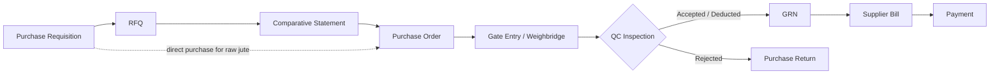
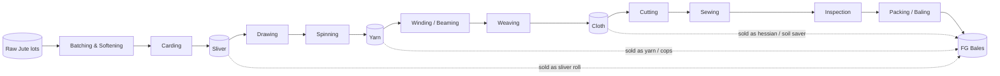

# JAL ERP — SRS Part 1

## Functional Requirements — Supply Chain & Manufacturing

Modules: Procurement (PRC) · Product Master (PRD) · Units of Measure (UOM) · Inventory & Warehouse (INV) · Production Planning & Control (MFG) · Quality Management (QMS)

Conventions: see [Part 0 §0.10](00_Introduction.md#010-requirement-conventions).

---

## 1.1 Procurement & Supplier Management (PRC)

### 1.1.1 Process Flow



### 1.1.2 Supplier Master

| ID | Requirement | Pri | Phase |
|---|---|---|---|
| FR-PRC-001 | Maintain supplier master: code, name, type (Raw jute — farmer/faria/bepari/aratdar/mill; Chemicals; Spares; Packaging; Services; Foreign), addresses, contacts, TIN, BIN, trade licence, bank accounts, payment terms, currency, credit limit. | M | P2 |
| FR-PRC-002 | Supplier approval workflow: Draft → Under Review → Approved / Blacklisted. Only Approved suppliers can receive POs. | M | P2 |
| FR-PRC-003 | Classify raw jute suppliers by region/purchase centre, supplied varieties and grades. | M | P2 |
| FR-PRC-004 | Store supplier documents (licence, TIN/BIN certificates) with expiry dates and alerts 30 days before expiry. | S | P2 |
| FR-PRC-005 | Maintain approved supplier–item list with last price, lead time and min order qty. | S | P2 |

### 1.1.3 Requisition, RFQ, Comparative Statement, PO

| ID | Requirement | Pri | Phase |
|---|---|---|---|
| FR-PRC-010 | Create Purchase Requisition (PR) by department/cost centre with item, qty, UOM, required date, purpose, and optional link to production order or maintenance work order. | M | P2 |
| FR-PRC-011 | System shows current stock, open PO qty and min/max level on each PR line. | M | P2 |
| FR-PRC-012 | Auto-generate PRs from reorder levels (min/max) and from MRP shortages (see MFG). | S | P2 |
| FR-PRC-013 | Create RFQ from one or more approved PRs; send to multiple suppliers by email (PDF). | M | P2 |
| FR-PRC-014 | Record supplier quotations (price, currency, delivery, payment terms, validity, taxes). | M | P2 |
| FR-PRC-015 | Generate Comparative Statement (CS) showing quotations side-by-side with lowest price highlighted, last purchase price and supplier rating; recommended supplier with justification required if not lowest. | M | P2 |
| FR-PRC-016 | Create PO from approved CS, PR, or directly (with permission). PO types: Local, Import (linked to Import LC), Raw Jute, Service, Framework/Rate Contract. | M | P2 |
| FR-PRC-017 | PO amendment with version history; amendments re-trigger approval if value increases beyond threshold. | M | P2 |
| FR-PRC-018 | PO lines carry tax codes (VAT, AIT, VDS) computed per configuration. | M | P2 |
| FR-PRC-019 | PO closure: auto when fully received; manual short-close with reason. | M | P2 |

### 1.1.4 Raw Jute Purchasing (JAL-specific)

| ID | Requirement | Pri | Phase |
|---|---|---|---|
| FR-PRC-030 | Raw jute PO/contract records variety (White, Tossa/Bogi, Mesta, etc.), grade, purchase centre, rate per maund/kg/bale, standard moisture %, and quality allowance terms. | M | P2 |
| FR-PRC-031 | Gate entry captures vehicle no., driver, supplier, PO, number of bales/bundles, time in/out. | M | P2 |
| FR-PRC-032 | Weighbridge entry captures gross, tare and net weight; manual entry with reason if weighbridge integration unavailable. | M | P2 |
| FR-PRC-033 | QC sampling captures moisture %, grade assessed, fibre quality, colour, root/cutting content, foreign matter. | M | P2 |
| FR-PRC-034 | System calculates **payable weight** and deductions per the configurable formula below. | M | P2 |
| FR-PRC-035 | Grade variance: if assessed grade differs from ordered grade, rate is adjusted per the grade-price matrix and requires approval. | M | P2 |
| FR-PRC-036 | Each raw jute receipt creates one or more **lots** (batch numbers) carrying supplier, grade, moisture, receipt date — used for downstream traceability. | M | P2 |
| FR-PRC-037 | Purchase-centre-wise and grade-wise price history and average cost reports. | S | P2 |

**BR-PRC-001 — Moisture deduction (default, configurable per contract)**

```
Excess moisture %       = max(0, Measured moisture % − Standard moisture %)
Moisture deduction (kg) = Net weight × Excess moisture % / 100
Other deductions (kg)   = Net weight × (Foreign matter % + Root-content excess %) / 100
Payable weight (kg)     = Net weight − Moisture deduction − Other deductions
Payable amount          = Payable weight × Rate per kg (grade-adjusted)
```

**BR-PRC-002** — A lot with measured moisture above the configured rejection threshold (e.g. 25%) cannot be accepted without a Quality Head override.

### 1.1.5 Receipt, Billing, Returns, Evaluation

| ID | Requirement | Pri | Phase |
|---|---|---|---|
| FR-PRC-040 | GRN created against PO (single or multiple POs per supplier), recording received, accepted, rejected qty, lot/batch, warehouse and bin. | M | P2 |
| FR-PRC-041 | GRN tolerance: over-receipt allowed up to configurable % per item category; beyond that requires approval. | M | P2 |
| FR-PRC-042 | Items flagged "QC required" are received into **Quality Hold** stock status until released by QMS. | M | P2 |
| FR-PRC-043 | Supplier bill entry with 3-way match (PO–GRN–Bill) on qty and price; mismatches beyond tolerance are blocked pending approval. | M | P2 |
| FR-PRC-044 | Purchase return against GRN with debit note generation. | M | P2 |
| FR-PRC-045 | Supplier advance payment against PO and adjustment against bills. | M | P2 |
| FR-PRC-046 | Supplier performance score per period: on-time delivery %, quality acceptance %, price competitiveness, moisture variance (raw jute). Weights configurable. | S | P2 |
| FR-PRC-047 | Service entry sheet for service POs (repairs, transport, contractors). | S | P2 |

---

## 1.2 Product Master & Specification Management (PRD)

### 1.2.1 Item Hierarchy

```
Item Type        → Raw Material | Semi-finished | Finished Good | Packaging | Spare | Consumable | Service
 └ Category      → e.g. Sacking Bag, Hessian Cloth, Sand Bag, Geo Product, Jute Yarn, Yarn Cops, Sliver
    └ Product    → e.g. Standard B' Twill (JAL-SB-001)
       └ Specification Revision (effective-dated)  → Rev A, Rev B …
          └ Customer Variant (optional)            → customer-specific overrides
```

### 1.2.2 Requirements

| ID | Requirement | Pri | Phase |
|---|---|---|---|
| FR-PRD-001 | Maintain item master with code, name, type, category, base UOM, alternate UOMs, valuation method, batch-tracked flag, QC-required flag, HS code, GL account group, min/max/reorder levels. | M | P1 |
| FR-PRD-002 | Item code auto-generated per category pattern (e.g. `JAL-SB-###`, `JAL-HC-###`, `RM-JUTE-###`). | M | P1 |
| FR-PRD-003 | **Category attribute templates**: each category defines its structured attributes, data types, units, allowed values and mandatory flags (see table below). | M | P1 |
| FR-PRD-004 | **Specification revisions**: every product has one or more revisions with effective-from/to dates and status (Draft, Active, Obsolete). Production and sales orders lock the revision in force at order date. | M | P3 |
| FR-PRD-005 | **Customer variants**: a sales contract line may override selected attributes (e.g. stripe colour, printing, bags per bale) without creating a new product master; the overrides are stored on the order and carried to production and QC. | M | P3 |
| FR-PRD-006 | Each product revision links to a default BOM, routing, QC inspection plan and packing specification. | M | P3 |
| FR-PRD-007 | Packing specification: units per bale, bale dimensions, net/gross bale weight, packing materials per bale, bales per 20'/40' container, marking/labelling instructions. | M | P3 |
| FR-PRD-008 | Duplicate check: system warns when a new product has the same category + key attributes as an existing one. | S | P1 |
| FR-PRD-009 | Initial load: consolidate the 17 product entries into 16 unique masters (Sugar Twills duplicate removed). | M | P1 |

### 1.2.3 Category Attribute Templates (initial)

| Category | Key attributes |
|---|---|
| Sacking Bag | Length (in), Width (in), Weight (g), Porter × Shots, Weave (twill/plain), Yarn count warp/weft, Mouth (hemmed/raw), Side stitch (Herackle/plain), Stripe colour, Stripe qty, Printing, Bags per bale, Bales per container |
| Hessian Cloth | Width (in), Weight (oz/sq yd), Porter × Shots, Yarn count, Roll/bale length (yd), Selvedge, Finish |
| Sand Bag | Size, Fabric (hessian), Laminated (Y/N), Lamination GSM, Tie string (Y/N), Bags per bale |
| Geo Jute Soil Saver | Width (m), GSM, Mesh opening (mm), Roll length (m), Treated (Y/N) |
| Jute Yarn | Count (lbs/spyndle), Ply, Twist (TPI), Quality (sacking/white/CRM), Package (roll/spool/cone) |
| Yarn Cops | Count (e.g. 28/1), Cop weight (g), Cops per bag |
| Jute Sliver | Sliver weight (g/m or lbs/100yd), Roll weight (kg) |

---

## 1.3 Units of Measure & Conversions (UOM)

| ID | Requirement | Pri | Phase |
|---|---|---|---|
| FR-UOM-001 | Maintain UOM master: Pcs, Kg, Lbs, Maund, Yard, Metre, Roll, Bale, Container-20, Container-40, Spyndle, Cop, etc. | M | P1 |
| FR-UOM-002 | Global conversions (Kg↔Lbs, Kg↔Maund, Yard↔Metre) with fixed factors. | M | P1 |
| FR-UOM-003 | **Item-specific conversions** (e.g. 1 Bale = 300 Pcs for B' Twill; 1 Container-20 = 65 Bales) defined on the product revision / packing spec. | M | P1 |
| FR-UOM-004 | Each item has exactly one **base UOM**; all stock is held in base UOM. Transactions may use any defined UOM; the system converts and stores both. | M | P1 |
| FR-UOM-005 | **Catch-weight** support: items like yarn rolls, sliver rolls and cloth rolls record both count (Roll) and actual weight (Kg) per transaction. | M | P2 |
| FR-UOM-006 | Rounding rules per UOM (decimals, rounding mode); Pcs and Bale are integers. | M | P1 |
| FR-UOM-007 | Packing calculator: for an order qty, compute bales, full containers, partial container, net/gross weight and packing material requirement. | M | P3 |

**BR-UOM-001 — Packing calculation (example B' Twill)**

```
Bales           = ceil(Order qty pcs / Bags per bale)            → 19,500 / 300 = 65
Full containers = floor(Bales / Bales per container)              → 65 / 65 = 1
Partial bales   = Order qty pcs mod Bags per bale                 → flagged for approval
Net weight (kg) = Order qty pcs × Bag weight (g) / 1000           → 19,500 × 1.020 = 19,890 kg
Gross weight    = Net weight + Bales × Packing material weight per bale
```

**BR-UOM-002** — Partial bales/containers are allowed only if the sales contract line has "partial shipment allowed" = Yes.

---

## 1.4 Inventory & Warehouse Management (INV)

### 1.4.1 Location Structure

```
Company → Factory → Warehouse → Zone → Rack → Bin
```

Initial warehouses: Raw Jute, Raw Material, Production Stores, Yarn, Fabric, Finished Goods, Packaging, Spare Parts, Export Dispatch. Plus virtual locations: **WIP (per work centre)**, **In-transit**, **Quality Hold**, **Rejected**, **Scrap/Waste**.

### 1.4.2 Stock Status

| Status | Meaning | Available for issue/dispatch |
|---|---|---|
| Unrestricted | Released, usable | Yes |
| Quality Hold | Awaiting QC decision | No |
| Blocked | Rejected / damaged / under investigation | No |
| Reserved | Allocated to a sales order or production order | Only for that order |
| In-transit | Moving between warehouses | No |

### 1.4.3 Requirements

| ID | Requirement | Pri | Phase |
|---|---|---|---|
| FR-INV-001 | Maintain multi-level locations; bin management optional per warehouse. | M | P2 |
| FR-INV-002 | Batch/lot tracking for raw jute, semi-finished and finished goods; lot carries origin (GRN or production order), date, attributes (grade, moisture, count). | M | P2 |
| FR-INV-003 | Serial/bale ID: each finished-goods bale gets a unique bale number and printable QR/barcode label. | M | P3 |
| FR-INV-004 | Stock transactions: Receipt (GRN, production), Issue (to production/department/maintenance), Return, Transfer (one-step / two-step via in-transit), Adjustment, Scrap, Dispatch. | M | P2 |
| FR-INV-005 | Material Issue Requisition from production/department → approval → issue slip; issue against production order updates consumption. | M | P2 |
| FR-INV-006 | Picking strategy configurable per item: FIFO (default), FEFO (chemicals with expiry), manual lot selection. | M | P2 |
| FR-INV-007 | Physical stock verification: freeze snapshot, count sheets / scanner count, variance report, approval, auto-adjustment posting. Support cycle counting by ABC class. | M | P2 |
| FR-INV-008 | Stock adjustments require reason code and approval per value threshold. | M | P2 |
| FR-INV-009 | Min / max / reorder level alerts; auto-PR suggestion. | S | P2 |
| FR-INV-010 | Stock aging by lot (0–30, 31–60, 61–90, 91–180, >180 days); slow/non-moving report. | M | P2 |
| FR-INV-011 | Valuation: **weighted average (perpetual)** per item per factory by default; batch-specific actual cost for finished goods produced (from production order costing). | M | P2 |
| FR-INV-012 | Every stock movement generates an accounting entry automatically (perpetual inventory). | M | P2 |
| FR-INV-013 | **Traceability**: forward (raw jute lot → production orders → FG bales → shipments → customers) and backward (bale → order → yarn/cloth lots → raw jute lots → suppliers). | M | P3 |
| FR-INV-014 | Real-time stock enquiry by item, lot, location, status, with quantity in base and alternate UOM. | M | P2 |
| FR-INV-015 | Mobile/handheld scanning for receipt, putaway, transfer, issue, picking and counting. | S | P5 |
| FR-INV-016 | Negative stock is not permitted (configurable exception for specified virtual WIP locations). | M | P2 |
| FR-INV-017 | Gate pass (returnable / non-returnable) for any material leaving the premises; returnable gate pass tracks expected return date. | M | P2 |

---

## 1.5 Production Planning & Control (MFG)

### 1.5.1 Manufacturing Model

JAL is a **process-plus-discrete** manufacturer: fibre-to-yarn is process manufacturing (continuous, weight-based, with loss), cloth-to-bag is discrete (count-based). The ERP models this as a **multi-level BOM with stage-wise production orders**, each stage producing a stockable semi-finished item.



### 1.5.2 Master Data

| ID | Requirement | Pri | Phase |
|---|---|---|---|
| FR-MFG-001 | **Work centres** per stage (e.g. Batching, Carding, Drawing, Spinning, Winding, Weaving — Sacking Looms, Weaving — Hessian Looms, Cutting, Sewing, Finishing/Inspection, Baling), with cost centre, shifts, capacity per hour, efficiency %. | M | P3 |
| FR-MFG-002 | **Machines** under each work centre (linked to CMMS asset register) with rated speed/capacity (e.g. kg/hr, picks/min, bags/hr). | M | P3 |
| FR-MFG-003 | **BOM** per product revision: output item and qty; input items and qty per output; scrap/loss % per input; by-products (e.g. caddis, card waste) with recovery value. Multi-level BOM. | M | P3 |
| FR-MFG-004 | **Routing** per product revision: sequence of operations, work centre, standard time/rate, standard labour and power per unit, QC checkpoints. | M | P3 |
| FR-MFG-005 | **Batch recipe** for batching: jute grade mix % (e.g. 60% grade A + 40% grade B), batching oil and water %. | M | P3 |
| FR-MFG-006 | BOM and routing versions are effective-dated and linked to product revisions. | M | P3 |

### 1.5.3 Planning

| ID | Requirement | Pri | Phase |
|---|---|---|---|
| FR-MFG-010 | **Master Production Schedule (MPS)** from confirmed sales contracts (MTO) and stock-replenishment targets (MTS), by week/day. | M | P3 |
| FR-MFG-011 | **MRP run**: explode MPS through BOM levels, net against stock, WIP, open production and purchase orders; propose production orders and PRs with dates. | S | P3 |
| FR-MFG-012 | **Capacity check (rough-cut)**: load vs. capacity per work centre per shift/day; overload highlighted. | S | P3 |
| FR-MFG-013 | Plan board: drag-and-drop production orders across machines/shifts (Gantt view). | C | P5 |
| FR-MFG-014 | Raw jute requirement forecast by grade for the next 4/8/12 weeks to guide purchasing. | S | P3 |

### 1.5.4 Execution

| ID | Requirement | Pri | Phase |
|---|---|---|---|
| FR-MFG-020 | **Production order** per stage (or multi-stage with operations): product, revision, customer variant (if MTO), planned qty, UOM, start/end dates, work centre, linked sales contract line. Status: Planned → Released → In Progress → Completed → Closed. | M | P3 |
| FR-MFG-021 | On release, system generates material requisition from BOM and reserves stock. | M | P3 |
| FR-MFG-022 | **Shift production entry** (web/tablet): date, shift, work centre, machine, operator/team, output qty (count and weight), run hours, idle/downtime with reason code, waste qty by type. | M | P3 |
| FR-MFG-023 | **Material consumption**: backflush (auto from BOM on output) or actual issue; per-item configuration. Actual vs. standard consumption variance recorded. | M | P3 |
| FR-MFG-024 | **Semi-finished receipt**: output of each stage is received into stock/WIP as a new lot linked to its input lots (genealogy). | M | P3 |
| FR-MFG-025 | **Waste management**: record waste by type (card waste, caddis, thread waste, cuttings, sweepings, rejected bags) per stage; waste goes to Scrap location with valuation for sale/reuse. | M | P3 |
| FR-MFG-026 | **Rework**: rejected output can be sent to rework order; rework cost accumulates to the original order. | M | P3 |
| FR-MFG-027 | **Finished goods receipt**: after final inspection and packing, bales are received into FG warehouse with bale IDs; only QC-passed qty is unrestricted. | M | P3 |
| FR-MFG-028 | Order close: computes yield, wastage %, material variance, labour/power usage, and triggers cost settlement (CST). | M | P3 |
| FR-MFG-029 | Subcontracting: send material to subcontractor (e.g. lamination), receive processed goods, record job-work charges. | S | P3 |
| FR-MFG-030 | Power consumption entry by work centre/meter per shift (manual or meter import) for costing. | S | P3 |

**BR-MFG-001 — Stage yield and wastage**

```
Stage yield %   = Output weight (kg) / Input weight (kg) × 100
Wastage %       = Total waste (kg) / Input weight (kg) × 100
Invisible loss% = 100 − Yield % − Wastage %       (moisture/handling loss; alert if > threshold)
```

**BR-MFG-002** — Output cannot exceed input weight × (1 + configured tolerance) at weight-based stages.

**BR-MFG-003** — A production order cannot be closed while it has unposted shift entries or open QC holds.

### 1.5.5 Production KPIs

Daily output vs. target (by stage, product, shift), machine utilisation %, loom efficiency %, yield %, wastage %, output per worker, power kWh per tonne, plan adherence %.

---

## 1.6 Quality Management (QMS)

### 1.6.1 Requirements

| ID | Requirement | Pri | Phase |
|---|---|---|---|
| FR-QMS-001 | **Inspection parameters master**: name, type (numeric/pass-fail/choice), unit, method. | M | P3 |
| FR-QMS-002 | **Inspection plans** per item/category/product revision and inspection point (incoming, in-process stage, final, pre-shipment), with spec limits (min/target/max), sample size, AQL level. | M | P3 |
| FR-QMS-003 | Inspection lots auto-created on GRN (QC-required items), on production output at configured stages, and on FG packing. | M | P3 |
| FR-QMS-004 | Result entry on tablet; out-of-spec values highlighted; overall decision: Accept, Accept with Deviation, Reject, Rework. | M | P3 |
| FR-QMS-005 | **Hold & release**: decision updates stock status (Quality Hold → Unrestricted/Blocked). Release of rejected material requires Quality Head authorisation with reason. | M | P3 |
| FR-QMS-006 | **Non-Conformance Report (NCR)** raised from any failed inspection or customer complaint: description, qty, root cause, disposition. | M | P3 |
| FR-QMS-007 | **CAPA** linked to NCR: actions, owner, due date, verification, effectiveness check, closure. | S | P3 |
| FR-QMS-008 | Supplier quality rating fed by incoming inspection results. | S | P3 |
| FR-QMS-009 | **Customer complaint** register linked to shipment, bale IDs, and traceability; resolution and credit note linkage. | S | P4 |
| FR-QMS-010 | Certificate of Analysis / inspection certificate generation per shipment. | S | P4 |
| FR-QMS-011 | Lab instrument readings (moisture meter, yarn strength tester) importable via CSV. | C | P5 |

**BR-QMS-001** — Material with status Quality Hold or Blocked **cannot be issued, picked or dispatched**. The dispatch screen performs a hard check per bale ID.

**BR-QMS-002** — Customer-variant specifications override base product limits on inspection lots created for that order.

### 1.6.2 Initial Inspection Plan Parameters

| Point | Parameters |
|---|---|
| Raw jute (incoming) | Moisture %, grade, colour, fibre strength, root content %, foreign matter % |
| Sliver | Sliver weight per unit length, CV % |
| Yarn | Count, strength (lbs), twist (TPI), moisture %, regain %, uniformity CV % |
| Cloth | Width, weight (oz/GSM), porter, shots, defects per 100 yd |
| Sacking bag | Length, width, weight, stitching (type, SPI), stripe colour & count, mouth finish |
| Hessian cloth | Width, oz, porter, shots, roll length |
| Soil saver | Width, GSM, mesh opening |
| Final / pre-shipment | Customer spec compliance, bale count, bale weight, marking, labelling |
