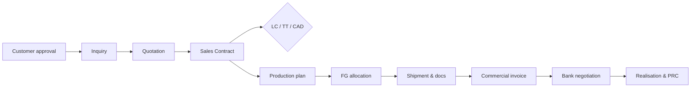

# JAL ERP — SRS Part 2

## Functional Requirements — Commercial, Finance, HR & Support

Modules: Sales & Export (SAL) · Commercial & LC (LC) · Logistics & Shipment (LOG) · Finance & Accounting (FIN) · Costing & Budgeting (CST) · HR & Payroll (HR) · Maintenance / CMMS (MNT) · Documents & Workflow (DMS) · Dashboards (DSH)

Conventions: see [Part 0 §0.10](00_Introduction.md#010-requirement-conventions).

---

## 2.1 Sales & Export Management (SAL)

### 2.1.1 Order-to-Cash Flow



### 2.1.2 Requirements

| ID | Requirement | Pri | Phase |
|---|---|---|---|
| FR-SAL-001 | Customer master: code, name, country, addresses (bill-to, ship-to, notify party), contacts, buyer's bank, currency, default Incoterm, payment terms (LC at sight, LC usance, CAD, TT advance), credit limit, agent/commission. | M | P2 |
| FR-SAL-002 | Customer approval workflow with KYC documents; only approved customers can receive quotations. | M | P2 |
| FR-SAL-003 | Inquiry register: product, specification, qty, destination, target price, required shipment date. | S | P2 |
| FR-SAL-004 | **Quotation** with product revision + customer variant attributes, price per unit (bag/yd/kg/MT), currency, Incoterm, port of loading/discharge, validity, packing. Margin preview from standard cost (CST). | M | P2 |
| FR-SAL-005 | Price approval: quotations below configured margin % or below price list require approval. | M | P2 |
| FR-SAL-006 | Export price list per product/country/customer/Incoterm with validity dates. | S | P2 |
| FR-SAL-007 | **Sales contract** (from quotation or buyer PO): lines with product, variant spec, qty, unit price, shipment schedule (multiple lots), tolerance (± %), partial shipment allowed, transhipment allowed, payment terms, LC link, commission. Contract amendments versioned. | M | P2 |
| FR-SAL-008 | Proforma invoice generation from sales contract. | M | P2 |
| FR-SAL-009 | Sales contract lines feed MPS (MTO) or allocate existing FG stock (MTS). | M | P3 |
| FR-SAL-010 | **FG allocation**: reserve specific bale IDs to a contract line; only QC-released bales matching the order specification/revision can be allocated. | M | P3 |
| FR-SAL-011 | Order book tracking: ordered, produced, allocated, shipped, invoiced, realised qty and value per contract line. | M | P2 |
| FR-SAL-012 | Commercial invoice per shipment (FOB value + freight + insurance per Incoterm), with HS code, marks & numbers, country of origin. | M | P4 |
| FR-SAL-013 | Export receivables ledger by customer, contract, invoice, LC; aging by due date. | M | P2 |
| FR-SAL-014 | Sales returns / claims with credit note and quality link (QMS). | S | P4 |
| FR-SAL-015 | Agent commission calculation and payable tracking. | S | P4 |
| FR-SAL-016 | Contract-wise and shipment-wise profitability (from CST). | M | P4 |
| FR-SAL-017 | Export **cash incentive** claim tracking for eligible jute goods exports: eligible invoices, claim rate (configurable), application date, received amount. | S | P4 |

**BR-SAL-001** — Shipment qty per contract line must be within contract qty ± tolerance; exceeding requires contract amendment.

**BR-SAL-002** — Customer credit check on contract approval for non-LC terms: outstanding + new value ≤ credit limit, else approval required.

---

## 2.2 Commercial & Letter of Credit Management (LC)

| ID | Requirement | Pri | Phase |
|---|---|---|---|
| FR-LC-001 | **Export LC register**: LC no., issuing bank, advising/negotiating bank, applicant, beneficiary, currency, amount, tolerance, issue date, expiry date & place, latest shipment date, tenor (sight/usance days), partial/transhipment, required documents list, special conditions. Linked to one or more sales contracts. | M | P4 |
| FR-LC-002 | **LC amendments** with sequence number, changed fields, acceptance status; LC position always reflects latest accepted amendment. | M | P4 |
| FR-LC-003 | LC utilisation: shipped value, documents submitted, accepted, realised, balance available. | M | P4 |
| FR-LC-004 | Alerts: latest shipment date and expiry approaching (configurable, default 15/7 days), document presentation deadline (default 21 days after B/L). | M | P4 |
| FR-LC-005 | **Back-to-back LC**: open import LC against a master export LC, with permitted % of export LC value (configurable), linked material POs, maturity date, and liability tracking. | S | P4 |
| FR-LC-006 | **Import LC**: proforma invoice, LCA/LCAF, LC opening, margin %, insurance cover note, shipping documents receipt, acceptance, payment/maturity, linked POs and GRNs. | M | P4 |
| FR-LC-007 | **Landed cost**: allocate LC charges, insurance, freight, customs duty, C&F agent charges, port charges to import GRN lines (by value/qty/weight). | M | P4 |
| FR-LC-008 | **Export document checklist** per LC/shipment: commercial invoice, packing list, B/L, Certificate of Origin, GSP/EPB certificate, inspection certificate, insurance certificate, beneficiary certificate, bill of exchange — status: Pending / Prepared / Submitted / Discrepant / Accepted. | M | P4 |
| FR-LC-009 | **Document submission** to bank: bill/negotiation no., submission date, discrepancies, acceptance date, maturity date (usance). | M | P4 |
| FR-LC-010 | **EXP form** register: EXP no., date, invoice value, linked LC/contract, shipment; realisation due date tracking per Bangladesh Bank rules (period configurable). | M | P4 |
| FR-LC-011 | **Export realisation**: realised amount, date, bank charges, discounting, FX rate, short realisation reason, PRC no.; posts to Finance automatically. | M | P4 |
| FR-LC-012 | Bank facility tracking: limits for export financing, packing credit, B2B LC, utilised and available. | S | P4 |
| FR-LC-013 | LC-wise financial position dashboard: LC value, shipped, outstanding, realised, B2B liability, charges. | M | P4 |

---

## 2.3 Logistics & Shipment (LOG)

| ID | Requirement | Pri | Phase |
|---|---|---|---|
| FR-LOG-001 | **Shipment plan** from contract shipment schedule: planned date, port of loading (Chattogram/Mongla), destination, container type and count (from packing calculator). | M | P4 |
| FR-LOG-002 | Freight forwarder / shipping line / C&F agent masters with rate agreements. | M | P4 |
| FR-LOG-003 | **Container booking**: booking no., vessel, voyage, ETD/ETA, cut-off dates, container nos., seal nos. | M | P4 |
| FR-LOG-004 | **Container stuffing**: scan bale IDs into each container; system validates bale QC status, allocation to the right contract line, and container capacity. | M | P4 |
| FR-LOG-005 | **Packing list** generated from stuffed bales: per container, bale nos., qty, net/gross weight, measurement (CBM). | M | P4 |
| FR-LOG-006 | **Delivery challan & gate pass** for trucks leaving factory to port/ICD; posts stock movement FG → In-transit (export). | M | P4 |
| FR-LOG-007 | Bill of Lading tracking: B/L no., date, on-board date (drives LC deadlines), type, release status. | M | P4 |
| FR-LOG-008 | Shipping bill / customs declaration reference, export clearance date. | M | P4 |
| FR-LOG-009 | Shipment expenses: inland transport, C&F, port, THC, freight (if CFR/CIF), insurance — linked to shipment for costing. | M | P4 |
| FR-LOG-010 | Shipment status tracker: Planned → Booked → Stuffed → Gated-out → On-board → Arrived → Delivered. | S | P4 |
| FR-LOG-011 | Container utilisation report: planned vs. actual bales/weight per container. | S | P4 |

**BR-LOG-001** — Shipment posting (on-board) transfers stock out of FG/in-transit and triggers revenue recognition per Incoterm (FOB/CFR/CIF: on shipment on board, configurable).

---

## 2.4 Finance & Accounting (FIN)

### 2.4.1 Accounting Dimensions

Every journal line carries: **Company, Factory, Department, Cost Centre, Production Line/Work Centre, Product, Customer/Supplier, Sales Contract/Export Order, Shipment, LC, Project** (optional, as applicable). Dimensions are validated per GL account rules (e.g. revenue requires Product and Customer).

### 2.4.2 Requirements

| ID | Requirement | Pri | Phase |
|---|---|---|---|
| FR-FIN-001 | **Chart of Accounts**: hierarchical (Class → Group → Sub-group → Ledger), account type, normal balance, dimension rules, control-account flag (AR/AP/Inventory only via sub-ledgers). | M | P1 |
| FR-FIN-002 | Vouchers: Journal, Payment (cash/bank), Receipt, Contra, Debit Note, Credit Note; multi-line, multi-currency, with dimensions and attachments. | M | P2 |
| FR-FIN-003 | **Automatic postings** from all modules via configurable posting rules (event → debit/credit accounts by item/category/party group). | M | P2 |
| FR-FIN-004 | **Accounts Payable**: supplier bills, advances, payments (cheque, EFT/BEFTN, RTGS), withholding (AIT/VDS), aging, payment proposal run by due date. | M | P2 |
| FR-FIN-005 | **Accounts Receivable**: export invoices (from SAL), local sales (waste sales, scrap), receipts, allocation, aging. | M | P2 |
| FR-FIN-006 | **Cash & Bank**: multiple bank accounts (BDT, FC accounts e.g. ERQ), cheque book register, cheque printing, bank reconciliation with statement import (CSV/MT940). | M | P2 |
| FR-FIN-007 | **Fixed Assets**: asset register (linked to CMMS machines), acquisition/capitalisation from GRN or CWIP, depreciation (straight-line / reducing balance, monthly), revaluation, transfer, impairment, disposal. | M | P2 |
| FR-FIN-008 | **Multi-currency**: daily exchange rates (manual or bank feed), realised FX gain/loss on settlement, period-end unrealised revaluation of FC receivables/payables/bank balances with auto-reversal. | M | P2 |
| FR-FIN-009 | **VAT & Tax**: VAT codes (zero-rated export, standard, exempt, reduced), input VAT tracking, VDS/AIT deduction and certificates, generation of statutory VAT registers (Mushak formats) as exportable reports. | M | P2 |
| FR-FIN-010 | **Budget control**: budgets by account × cost centre × month; PR/PO checks against available budget (warn or block, configurable). | S | P3 |
| FR-FIN-011 | Period close checklist: inventory valuation, depreciation run, FX revaluation, accruals, cost settlement, lock period. | M | P2 |
| FR-FIN-012 | **Financial statements**: Trial Balance, Balance Sheet, P&L, Cash Flow (indirect), Statement of Changes in Equity, with comparatives and drill-down to vouchers and source documents. | M | P2 |
| FR-FIN-013 | Multi-dimensional P&L by any dimension combination (e.g. product × customer × month). | M | P3 |
| FR-FIN-014 | Year-end closing: transfer P&L to retained earnings, carry forward balances. | M | P2 |
| FR-FIN-015 | Inter-company / consolidation-ready: company dimension and elimination tagging (for future Samuda group consolidation). | C | P5 |
| FR-FIN-016 | Petty cash / imprest management with replenishment. | S | P2 |

**BR-FIN-001** — Every voucher must balance in functional currency; posted vouchers are immutable (correction by reversal).

**BR-FIN-002** — Control accounts (AR, AP, Inventory, Fixed Assets) cannot be posted to by manual journals.

---

## 2.5 Costing & Budgeting (CST)

### 2.5.1 Costing Method

- **Standard costing** for planning, quotation and variance analysis (standard cost roll-up through BOM + routing).
- **Actual process costing** per production order (stage-wise), with costs flowing stage to stage via semi-finished lots.
- **Order/shipment costing** adds selling, freight, export and financing costs to product cost.

### 2.5.2 Cost Build-up per Stage

```
Stage cost = Materials consumed (actual qty × weighted avg cost, incl. input from previous stage)
           + Direct labour     (attendance hours/wages allocated by work centre)
           + Power             (kWh by work centre × tariff, or allocated by machine hours)
           + Maintenance       (work orders & spares charged to work centre)
           + Depreciation      (machine-wise depreciation of the work centre)
           + Factory overhead  (allocated by configurable driver: machine hrs / output kg / labour hrs)
           − By-product/waste credit (waste qty × realisable value)

Unit cost of stage output = Stage cost / Good output qty (base UOM)
```

```
Product cost (FG)         = Σ stage costs along the route + Packaging materials
Shipment cost             = Σ FG cost of bales shipped + inland freight + C&F + port
                            + ocean freight & insurance (if CFR/CIF) + export doc & bank charges
                            + agent commission + financing cost (optional)
Contribution / gross margin = Net realised revenue − Shipment cost
```

### 2.5.3 Requirements

| ID | Requirement | Pri | Phase |
|---|---|---|---|
| FR-CST-001 | Cost element master mapped to GL accounts (materials, wages, power, overhead, depreciation, maintenance, packaging, freight, export charges, bank charges). | M | P3 |
| FR-CST-002 | **Standard cost roll-up** per product revision from BOM, routing standards and rate tables; versioned per period; mass re-roll on rate change. | M | P3 |
| FR-CST-003 | **Overhead allocation** engine: cost centre pools → work centres → production orders, by configurable drivers and rates; run monthly (actual) with optional provisional rates during the month. | M | P3 |
| FR-CST-004 | **Production order actual cost** at close: materials, labour, power, overhead, waste credit; variances vs. standard (price, usage, yield, efficiency, volume). | M | P3 |
| FR-CST-005 | Finished goods valued at actual cost; WIP valuation at period end for open orders. | M | P3 |
| FR-CST-006 | Unit cost in all relevant UOMs: per kg, per bag, per bale, per yard, per roll, per container. | M | P3 |
| FR-CST-007 | **Order/contract profitability**: revenue, product cost, shipment and export costs, commission → margin per contract line, contract, customer, country. | M | P4 |
| FR-CST-008 | **Quotation costing**: estimated cost of a new specification (what-if on bag weight, yarn count, stripes) using standard rates. | S | P3 |
| FR-CST-009 | Product-wise gross profit and cost trend reports. | M | P3 |
| FR-CST-010 | Budgets: production volume, sales, purchase, departmental expense and capex budgets by month; budget vs. actual with variance %. | S | P3 |
| FR-CST-011 | Cost of quality: rejection, rework, claims cost by product and stage. | S | P4 |

---

## 2.6 HR & Payroll (HR)

### 2.6.1 Requirements — HR Core

| ID | Requirement | Pri | Phase |
|---|---|---|---|
| FR-HR-001 | Employee master: ID, name (English/Bangla), photo, NID, DOB, gender, address, contacts, emergency contact, nominee, education, experience, bank/MFS account, joining date, confirmation date, category (Permanent/Probationary/Contractual/Daily/Casual), grade, designation, department, section, line, shift group, reporting manager, wage basis. | M | P4 |
| FR-HR-002 | Organisation hierarchy: Company → Division → Department → Section → Line/Unit; position management. | M | P4 |
| FR-HR-003 | Recruitment: requisition, candidate, interview, offer letter, appointment letter, onboarding checklist, ID card print. | S | P4 |
| FR-HR-004 | Employment lifecycle: probation, confirmation, transfer, promotion, increment, disciplinary actions, separation (resignation, termination, retirement, death) — each with effective date and letter generation. | M | P4 |
| FR-HR-005 | Document vault per employee with expiry alerts. | S | P4 |
| FR-HR-006 | Training records and needs; performance appraisal for management staff. | C | P5 |

### 2.6.2 Time & Attendance

| ID | Requirement | Pri | Phase |
|---|---|---|---|
| FR-HR-010 | Shift master (e.g. A/B/C 8-hour shifts, general shift), grace time, break, night-shift flag, crossing-midnight handling. | M | P4 |
| FR-HR-011 | Roster: shift assignment by group/line with rotation patterns; weekly holiday and holiday calendar. | M | P4 |
| FR-HR-012 | Attendance import from biometric/RFID devices (real-time or scheduled pull), with raw punch log retained. | M | P4 |
| FR-HR-013 | Daily attendance processing: present, absent, late, early out, leave, holiday, weekly off, on-duty, missing punch; manual correction with approval. | M | P4 |
| FR-HR-014 | **Overtime** computed from punches beyond shift hours, subject to daily/weekly/monthly caps (configurable per Labour Act), approval by line in-charge. | M | P4 |
| FR-HR-015 | Leave types (casual, sick, earned/annual, maternity, festival, compensatory) with entitlement rules, accrual, carry-forward, encashment; leave application and approval (web/mobile). | M | P4 |
| FR-HR-016 | Link worker attendance hours to work centres for labour costing. | M | P4 |

### 2.6.3 Payroll

| ID | Requirement | Pri | Phase |
|---|---|---|---|
| FR-HR-020 | Pay structure per grade: basic, house rent, medical, conveyance, food (configurable formulae, e.g. basic as % of gross). | M | P4 |
| FR-HR-021 | Wage bases: **monthly**, **daily** (days × rate), **piece-rate** (production output from MFG shift entries × rate per unit per operation), and hybrid (guaranteed minimum + incentive). | M | P4 |
| FR-HR-022 | Earnings: overtime (rate formula configurable, default 2 × basic hourly), attendance bonus, production incentive, night allowance, festival bonuses (two per year, eligibility rules), arrears. | M | P4 |
| FR-HR-023 | Deductions: absence, advance/loan instalments, PF contribution, income tax (TDS on salary), canteen, stamp, other. | M | P4 |
| FR-HR-024 | Loans & advances: application, approval, disbursement, instalment schedule, auto-deduction, settlement. | M | P4 |
| FR-HR-025 | Provident fund (employee/employer contribution, ledger, interest) and gratuity provision/calculation where applicable. | S | P4 |
| FR-HR-026 | Payroll run per period per pay group: preview, variance check vs. previous month, lock, approve, post to Finance (by cost centre/department), generate bank/MFS advice files and cash pay sheets. | M | P4 |
| FR-HR-027 | Payslips (English/Bangla) — print, email, and employee self-service. | M | P4 |
| FR-HR-028 | Final settlement: dues, notice pay, leave encashment, gratuity, deductions, clearance checklist. | M | P4 |
| FR-HR-029 | Statutory reports: wage register, overtime register, leave register, service book, tax certificates. | M | P4 |
| FR-HR-030 | Payroll processing for ~2,800 employees completes within 15 minutes (see NFR). | M | P4 |

**BR-HR-001** — No employee's net wage may fall below the applicable statutory minimum wage for their grade; the payroll run flags violations and blocks approval.

---

## 2.7 Plant Maintenance — CMMS (MNT)

| ID | Requirement | Pri | Phase |
|---|---|---|---|
| FR-MNT-001 | Equipment register: asset no. (linked to fixed asset), machine type (breaker/finisher card, drawing frame, spinning frame, winding, loom, sewing machine, baling press, boiler, generator, compressor), make/model, location, work centre, commissioning date, specifications, criticality (A/B/C). | M | P5 |
| FR-MNT-002 | Equipment hierarchy (machine → assembly → component) and spare parts BOM per machine. | S | P5 |
| FR-MNT-003 | **Preventive maintenance plans**: time-based (days) or usage-based (running hours/output), task lists, required spares, skills, estimated hours; auto-generation of PM work orders. | M | P5 |
| FR-MNT-004 | **Breakdown request** from shop floor (mobile): machine, symptom, time stopped; notifies maintenance. | M | P5 |
| FR-MNT-005 | **Work orders**: type (PM, breakdown, corrective, project), assigned technicians, start/end times, labour hours, spares issued from store, external service cost, failure code, cause, action. | M | P5 |
| FR-MNT-006 | Downtime automatically recorded from breakdown start to work-order completion and fed to production (MFG) machine availability. | M | P5 |
| FR-MNT-007 | Maintenance cost per machine/work centre posted to costing. | M | P5 |
| FR-MNT-008 | KPIs: MTBF, MTTR, availability %, planned vs. unplanned downtime, PM compliance %, maintenance cost per unit of output. | M | P5 |
| FR-MNT-009 | Utility meters (power, steam, compressed air) readings per shift for costing. | S | P5 |

```
MTBF         = Total operating time / Number of failures
MTTR         = Total repair time / Number of repairs
Availability = (Planned production time − Downtime) / Planned production time × 100
```

---

## 2.8 Document Management & Approval Workflow (DMS)

| ID | Requirement | Pri | Phase |
|---|---|---|---|
| FR-DMS-001 | Attach files (PDF, images, Office docs; max 25 MB each) to any record; stored in S3-compatible storage with metadata, version history and access inherited from the parent record. | M | P2 |
| FR-DMS-002 | Document types with mandatory-attachment rules (e.g. supplier trade licence, LC copy, B/L). | S | P2 |
| FR-DMS-003 | Full-text search on document metadata; OCR on scanned docs (optional). | C | P5 |
| FR-DMS-004 | **Workflow engine**: approval routes defined per document type with conditions on amount, department, item category, currency, deviation flags; sequential and parallel steps; designation-based or named approvers. | M | P2 |
| FR-DMS-005 | Approval actions: Approve, Reject (reason required), Return for correction, Forward, Delegate; approve from email link or mobile app. | M | P2 |
| FR-DMS-006 | Delegation of authority (out-of-office) with date range. | M | P2 |
| FR-DMS-007 | Escalation: if no action within SLA (configurable hours), escalate to next level and notify. | S | P2 |
| FR-DMS-008 | Approval history shown on each document and printed on approved PDFs. | M | P2 |

---

## 2.9 Enterprise Dashboards (DSH)

| ID | Requirement | Pri | Phase |
|---|---|---|---|
| FR-DSH-001 | Role-based home dashboards: Board/Samuda, CEO, CFO, Factory Head, Production Head, Commercial Head, HR Head, department managers. | M | P3 |
| FR-DSH-002 | KPI tiles with target, actual, trend sparkline and RAG status; click-through to detail report. | M | P3 |
| FR-DSH-003 | Data freshness: operational KPIs (production, stock, attendance) near-real-time (≤ 15 min); financial KPIs as of last posting. | M | P3 |
| FR-DSH-004 | Exception alerts: production below target, wastage above threshold, LC expiry, overdue receivables, stock below minimum, machine down > X hrs. | M | P3 |
| FR-DSH-005 | Monthly management pack (PDF) auto-generated and emailed to Samuda oversight. | S | P4 |
| FR-DSH-006 | BI integration (Metabase / Power BI) via read-only reporting schema. | S | P5 |

Detailed KPI and report catalogue: [Part 4 §4.5](04_Security_Workflow_UI_Reports.md#45-mis-report-catalogue).
