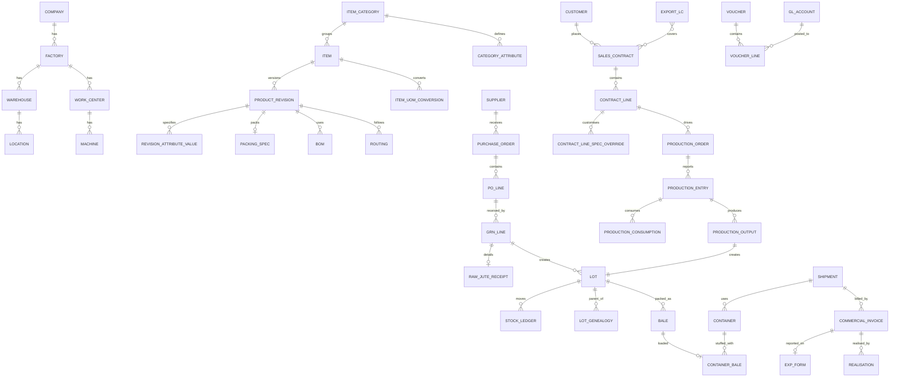

# JAL ERP — SRS Part 3

## Data Model & Database Design

Target database: **PostgreSQL 16+**. This part defines conventions, the domain model, and DDL for the core tables that carry the JAL-specific design decisions (product specifications, multi-UOM, lots/genealogy, stock ledger, production, export/LC, dimensions). Remaining tables are listed per schema and will be detailed during Phase 1 design.

---

## 3.1 Conventions

| Topic | Convention |
|---|---|
| Schemas | One PostgreSQL schema per module: `core`, `mdm`, `prc`, `inv`, `mfg`, `qms`, `sal`, `lc`, `log`, `fin`, `cst`, `hr`, `mnt`, `dms`, `wf`, `audit`, `rpt` (read-only reporting views). |
| Naming | `snake_case`; tables singular (`purchase_order`); FK columns `<table>_id`. |
| Keys | `id BIGINT GENERATED ALWAYS AS IDENTITY` primary keys; public-facing UUID `uid` on documents for API/QR use. |
| Tenancy | Every business table has `company_id`; factory-scoped tables also `factory_id`. Row-level security policies enforce company/factory access. |
| Audit columns | `created_at, created_by, updated_at, updated_by, version INT` (optimistic locking). |
| Documents | Header/line pattern; header has `doc_no`, `doc_date`, `status`, `fiscal_year`, `posted_at`. |
| Money | `NUMERIC(18,4)` amount + `currency_code CHAR(3)`; functional amount `NUMERIC(18,4)` + `fx_rate NUMERIC(18,8)`. |
| Quantity | `NUMERIC(18,4)` in transaction UOM + `qty_base NUMERIC(18,4)` in item base UOM; catch-weight `weight_kg NUMERIC(18,4)`. |
| Soft delete | `is_active BOOLEAN` on masters; no physical deletes of referenced rows. |
| Enumerations | PostgreSQL `TEXT` with `CHECK` constraints (or lookup tables where user-configurable). |
| Flexible attributes | Typed attribute tables (EAV with type columns) for product specifications; `JSONB` only for non-queried extras. |
| Migrations | Versioned SQL migrations (e.g. via Prisma Migrate / node-pg-migrate) — no manual DDL in production. |
| Extensions | `btree_gist` (exclusion constraints on effective-dated revisions), `pg_trgm` (fuzzy search). |

> The DDL below is illustrative of structure and constraints; it is grouped by schema for readability, not in dependency order. Tables referenced but not shown are listed in §3.4.

---

## 3.2 Domain Model (high level)



---

## 3.3 Core DDL

### 3.3.1 Organisation & Dimensions (`core`)

```sql
CREATE TABLE core.company (
  id            BIGINT GENERATED ALWAYS AS IDENTITY PRIMARY KEY,
  code          TEXT NOT NULL UNIQUE,            -- 'JAL'
  name          TEXT NOT NULL,
  functional_currency CHAR(3) NOT NULL DEFAULT 'BDT',
  fiscal_year_start_month SMALLINT NOT NULL DEFAULT 7,
  tin TEXT, bin TEXT,
  is_active     BOOLEAN NOT NULL DEFAULT TRUE
);

CREATE TABLE core.factory (
  id         BIGINT GENERATED ALWAYS AS IDENTITY PRIMARY KEY,
  company_id BIGINT NOT NULL REFERENCES core.company(id),
  code       TEXT NOT NULL,
  name       TEXT NOT NULL,
  UNIQUE (company_id, code)
);

CREATE TABLE core.cost_center (
  id            BIGINT GENERATED ALWAYS AS IDENTITY PRIMARY KEY,
  company_id    BIGINT NOT NULL REFERENCES core.company(id),
  factory_id    BIGINT REFERENCES core.factory(id),
  department_id BIGINT REFERENCES core.department(id),
  code          TEXT NOT NULL,
  name          TEXT NOT NULL,
  cc_type       TEXT NOT NULL CHECK (cc_type IN ('PRODUCTION','SERVICE','ADMIN','SELLING')),
  parent_id     BIGINT REFERENCES core.cost_center(id),
  UNIQUE (company_id, code)
);
```

### 3.3.2 Items, Specifications & UOM (`mdm`)

```sql
CREATE TABLE mdm.uom (
  code        TEXT PRIMARY KEY,                  -- 'PCS','KG','LBS','MAUND','YD','M','ROLL','BALE','CTR20','CTR40'
  name        TEXT NOT NULL,
  uom_class   TEXT NOT NULL CHECK (uom_class IN ('COUNT','WEIGHT','LENGTH','PACK')),
  decimals    SMALLINT NOT NULL DEFAULT 0
);

CREATE TABLE mdm.uom_conversion_global (       -- fixed physical conversions
  from_uom TEXT REFERENCES mdm.uom(code),
  to_uom   TEXT REFERENCES mdm.uom(code),
  factor   NUMERIC(20,10) NOT NULL,             -- qty_to = qty_from * factor
  PRIMARY KEY (from_uom, to_uom)
);

CREATE TABLE mdm.item_category (
  id        BIGINT GENERATED ALWAYS AS IDENTITY PRIMARY KEY,
  company_id BIGINT NOT NULL REFERENCES core.company(id),
  code      TEXT NOT NULL,                       -- 'SB','HC','SAND','GEO','YARN','COPS','SLIVER','RJ'
  name      TEXT NOT NULL,
  item_type TEXT NOT NULL CHECK (item_type IN ('RAW','SEMI','FG','PACK','SPARE','CONSUMABLE','SERVICE')),
  code_pattern TEXT,                             -- 'JAL-SB-{###}'
  UNIQUE (company_id, code)
);

CREATE TABLE mdm.category_attribute (            -- attribute template per category
  id            BIGINT GENERATED ALWAYS AS IDENTITY PRIMARY KEY,
  category_id   BIGINT NOT NULL REFERENCES mdm.item_category(id),
  code          TEXT NOT NULL,                   -- 'LENGTH_IN','WEIGHT_G','PORTER','SHOTS','STRIPE_COLOUR'
  label         TEXT NOT NULL,
  data_type     TEXT NOT NULL CHECK (data_type IN ('NUMBER','TEXT','CHOICE','BOOLEAN')),
  unit          TEXT,
  allowed_values TEXT[],
  is_mandatory  BOOLEAN NOT NULL DEFAULT FALSE,
  is_key        BOOLEAN NOT NULL DEFAULT FALSE,  -- used in duplicate detection
  is_customer_overridable BOOLEAN NOT NULL DEFAULT FALSE,
  sort_order    INT NOT NULL DEFAULT 0,
  UNIQUE (category_id, code)
);

CREATE TABLE mdm.item (
  id            BIGINT GENERATED ALWAYS AS IDENTITY PRIMARY KEY,
  company_id    BIGINT NOT NULL REFERENCES core.company(id),
  category_id   BIGINT NOT NULL REFERENCES mdm.item_category(id),
  code          TEXT NOT NULL,
  name          TEXT NOT NULL,
  base_uom      TEXT NOT NULL REFERENCES mdm.uom(code),
  is_batch_tracked BOOLEAN NOT NULL DEFAULT FALSE,
  is_catch_weight  BOOLEAN NOT NULL DEFAULT FALSE,
  qc_required      BOOLEAN NOT NULL DEFAULT FALSE,
  valuation_method TEXT NOT NULL DEFAULT 'WAVG' CHECK (valuation_method IN ('WAVG','BATCH_ACTUAL','STANDARD')),
  hs_code       TEXT,
  gl_group_id   BIGINT,
  min_qty NUMERIC(18,4), max_qty NUMERIC(18,4), reorder_qty NUMERIC(18,4),
  is_active     BOOLEAN NOT NULL DEFAULT TRUE,
  UNIQUE (company_id, code)
);

CREATE TABLE mdm.item_uom_conversion (           -- item-specific: 1 BALE = 300 PCS
  item_id   BIGINT NOT NULL REFERENCES mdm.item(id),
  revision_id BIGINT REFERENCES mdm.product_revision(id), -- NULL = all revisions
  uom       TEXT NOT NULL REFERENCES mdm.uom(code),
  qty_in_base NUMERIC(20,10) NOT NULL            -- base units per 1 uom
);
CREATE UNIQUE INDEX ux_item_uom_conv
  ON mdm.item_uom_conversion (item_id, uom, COALESCE(revision_id, 0));

CREATE TABLE mdm.product_revision (
  id             BIGINT GENERATED ALWAYS AS IDENTITY PRIMARY KEY,
  item_id        BIGINT NOT NULL REFERENCES mdm.item(id),
  revision       TEXT NOT NULL,                  -- 'A','B'
  status         TEXT NOT NULL CHECK (status IN ('DRAFT','ACTIVE','OBSOLETE')),
  effective_from DATE NOT NULL,
  effective_to   DATE,
  change_note    TEXT,
  UNIQUE (item_id, revision),
  EXCLUDE USING gist (item_id WITH =, daterange(effective_from, effective_to, '[)') WITH &&)
    WHERE (status = 'ACTIVE')                    -- no overlapping active revisions
);

CREATE TABLE mdm.revision_attribute_value (
  revision_id   BIGINT NOT NULL REFERENCES mdm.product_revision(id),
  attribute_id  BIGINT NOT NULL REFERENCES mdm.category_attribute(id),
  value_num     NUMERIC(18,4),
  value_text    TEXT,
  value_bool    BOOLEAN,
  min_tol NUMERIC(18,4), max_tol NUMERIC(18,4),  -- QC tolerance
  PRIMARY KEY (revision_id, attribute_id)
);

CREATE TABLE mdm.packing_spec (
  revision_id        BIGINT PRIMARY KEY REFERENCES mdm.product_revision(id),
  units_per_bale     NUMERIC(18,4) NOT NULL,      -- 300 bags
  bales_per_ctr20    INT,                         -- 65
  bales_per_ctr40    INT,
  bale_net_kg        NUMERIC(18,4),
  bale_packing_kg    NUMERIC(18,4),
  bale_cbm           NUMERIC(18,4),
  marking_instructions TEXT
);
```

### 3.3.3 Inventory (`inv`)

```sql
CREATE TABLE inv.lot (
  id            BIGINT GENERATED ALWAYS AS IDENTITY PRIMARY KEY,
  company_id    BIGINT NOT NULL,
  item_id       BIGINT NOT NULL REFERENCES mdm.item(id),
  revision_id   BIGINT REFERENCES mdm.product_revision(id),
  lot_no        TEXT NOT NULL,
  source_type   TEXT NOT NULL CHECK (source_type IN ('GRN','PRODUCTION','ADJUSTMENT','OPENING')),
  source_id     BIGINT NOT NULL,
  mfg_date      DATE,
  expiry_date   DATE,
  attributes    JSONB,                           -- grade, moisture %, count etc. snapshot
  qc_status     TEXT NOT NULL DEFAULT 'UNRESTRICTED'
                CHECK (qc_status IN ('QUALITY_HOLD','UNRESTRICTED','BLOCKED')),
  unit_cost     NUMERIC(18,6),                   -- actual cost (batch-valued items)
  UNIQUE (company_id, item_id, lot_no)
);

CREATE TABLE inv.lot_genealogy (                 -- input lot -> output lot
  parent_lot_id BIGINT NOT NULL REFERENCES inv.lot(id),
  child_lot_id  BIGINT NOT NULL REFERENCES inv.lot(id),
  qty_base      NUMERIC(18,4) NOT NULL,
  production_entry_id BIGINT,
  PRIMARY KEY (parent_lot_id, child_lot_id)
);

CREATE TABLE inv.bale (                          -- finished goods bale identity
  id           BIGINT GENERATED ALWAYS AS IDENTITY PRIMARY KEY,
  bale_no      TEXT NOT NULL UNIQUE,             -- printed on QR label
  lot_id       BIGINT NOT NULL REFERENCES inv.lot(id),
  qty_base     NUMERIC(18,4) NOT NULL,           -- e.g. 300 pcs
  net_kg       NUMERIC(18,4), gross_kg NUMERIC(18,4),
  location_id  BIGINT REFERENCES inv.location(id),
  contract_line_id BIGINT,                       -- allocation
  status       TEXT NOT NULL CHECK (status IN ('IN_STOCK','ALLOCATED','STUFFED','SHIPPED','RETURNED','SCRAPPED'))
);

-- Append-only stock ledger: the single source of truth for stock & valuation
CREATE TABLE inv.stock_ledger (
  id            BIGINT GENERATED ALWAYS AS IDENTITY PRIMARY KEY,
  company_id    BIGINT NOT NULL,
  factory_id    BIGINT NOT NULL,
  posting_ts    TIMESTAMPTZ NOT NULL,
  item_id       BIGINT NOT NULL,
  lot_id        BIGINT,
  location_id   BIGINT NOT NULL,
  stock_status  TEXT NOT NULL,                   -- UNRESTRICTED / QUALITY_HOLD / BLOCKED / RESERVED / IN_TRANSIT
  movement_type TEXT NOT NULL,                   -- GRN, ISSUE_PROD, RECEIPT_PROD, TRANSFER_OUT, TRANSFER_IN, ADJ, SCRAP, DISPATCH ...
  doc_type      TEXT NOT NULL,
  doc_id        BIGINT NOT NULL,
  doc_line_id   BIGINT,
  qty_txn       NUMERIC(18,4) NOT NULL,
  uom_txn       TEXT NOT NULL,
  qty_base      NUMERIC(18,4) NOT NULL,          -- signed: + in, − out
  weight_kg     NUMERIC(18,4),                   -- catch weight, signed
  unit_cost     NUMERIC(18,6) NOT NULL,
  value_fc      NUMERIC(18,4) NOT NULL,          -- signed, functional currency
  voucher_id    BIGINT                           -- link to GL posting
) PARTITION BY RANGE (posting_ts);

-- Materialised current balances (maintained transactionally)
CREATE TABLE inv.stock_balance (
  item_id BIGINT, lot_id BIGINT, location_id BIGINT, stock_status TEXT,
  qty_base NUMERIC(18,4) NOT NULL, weight_kg NUMERIC(18,4), value_fc NUMERIC(18,4) NOT NULL,
  CHECK (qty_base >= 0)                          -- BR: no negative stock
);
CREATE UNIQUE INDEX ux_stock_balance
  ON inv.stock_balance (item_id, COALESCE(lot_id, 0), location_id, stock_status);
```

### 3.3.4 Raw Jute Receipt (`prc`)

```sql
CREATE TABLE prc.raw_jute_receipt (
  grn_line_id        BIGINT PRIMARY KEY REFERENCES prc.grn_line(id),
  purchase_centre    TEXT,
  variety            TEXT NOT NULL,              -- WHITE / TOSSA / MESTA
  ordered_grade      TEXT NOT NULL,
  assessed_grade     TEXT NOT NULL,
  bales_or_bundles   INT,
  gross_kg           NUMERIC(18,3) NOT NULL,
  tare_kg            NUMERIC(18,3) NOT NULL,
  net_kg             NUMERIC(18,3) GENERATED ALWAYS AS (gross_kg - tare_kg) STORED,
  standard_moisture_pct NUMERIC(6,2) NOT NULL,
  measured_moisture_pct NUMERIC(6,2) NOT NULL,
  foreign_matter_pct NUMERIC(6,2) DEFAULT 0,
  root_excess_pct    NUMERIC(6,2) DEFAULT 0,
  moisture_deduction_kg NUMERIC(18,3) NOT NULL,
  other_deduction_kg NUMERIC(18,3) NOT NULL,
  payable_kg         NUMERIC(18,3) NOT NULL,
  rate_per_kg        NUMERIC(18,4) NOT NULL,    -- grade-adjusted
  weighbridge_ticket TEXT
);
```

### 3.3.5 Production (`mfg`)

```sql
CREATE TABLE mfg.production_order (
  id              BIGINT GENERATED ALWAYS AS IDENTITY PRIMARY KEY,
  company_id      BIGINT NOT NULL, factory_id BIGINT NOT NULL,
  doc_no          TEXT NOT NULL UNIQUE,
  item_id         BIGINT NOT NULL REFERENCES mdm.item(id),
  revision_id     BIGINT NOT NULL REFERENCES mdm.product_revision(id),
  bom_id          BIGINT NOT NULL, routing_id BIGINT NOT NULL,
  contract_line_id BIGINT,                       -- MTO link (NULL for MTS)
  stage           TEXT NOT NULL,                 -- BATCHING, CARDING, ..., PACKING
  work_center_id  BIGINT NOT NULL,
  planned_qty     NUMERIC(18,4) NOT NULL, uom TEXT NOT NULL,
  planned_start   DATE, planned_end DATE,
  status          TEXT NOT NULL CHECK (status IN ('PLANNED','RELEASED','IN_PROGRESS','COMPLETED','CLOSED','CANCELLED')),
  parent_order_id BIGINT REFERENCES mfg.production_order(id)
);

CREATE TABLE mfg.production_entry (              -- one per order × shift × machine
  id               BIGINT GENERATED ALWAYS AS IDENTITY PRIMARY KEY,
  production_order_id BIGINT NOT NULL REFERENCES mfg.production_order(id),
  entry_date       DATE NOT NULL,
  shift_code       TEXT NOT NULL,
  machine_id       BIGINT,
  supervisor_emp_id BIGINT,
  run_minutes      INT NOT NULL DEFAULT 0,
  downtime_minutes INT NOT NULL DEFAULT 0,
  status           TEXT NOT NULL CHECK (status IN ('DRAFT','POSTED','REVERSED'))
);

CREATE TABLE mfg.production_consumption (
  id BIGINT GENERATED ALWAYS AS IDENTITY PRIMARY KEY,
  production_entry_id BIGINT NOT NULL REFERENCES mfg.production_entry(id),
  item_id BIGINT NOT NULL, lot_id BIGINT,
  qty_base NUMERIC(18,4) NOT NULL, weight_kg NUMERIC(18,4),
  standard_qty_base NUMERIC(18,4),               -- for usage variance
  method TEXT NOT NULL CHECK (method IN ('BACKFLUSH','ACTUAL'))
);

CREATE TABLE mfg.production_output (
  id BIGINT GENERATED ALWAYS AS IDENTITY PRIMARY KEY,
  production_entry_id BIGINT NOT NULL REFERENCES mfg.production_entry(id),
  item_id BIGINT NOT NULL, lot_id BIGINT NOT NULL REFERENCES inv.lot(id),
  output_type TEXT NOT NULL CHECK (output_type IN ('GOOD','REWORK','REJECT','BYPRODUCT','WASTE')),
  waste_type TEXT,                               -- CARD_WASTE, CADDIS, THREAD, CUTTINGS ...
  qty_base NUMERIC(18,4) NOT NULL, weight_kg NUMERIC(18,4)
);

CREATE TABLE mfg.downtime_event (
  id BIGINT GENERATED ALWAYS AS IDENTITY PRIMARY KEY,
  machine_id BIGINT NOT NULL,
  production_entry_id BIGINT,
  maintenance_wo_id BIGINT,
  reason_code TEXT NOT NULL,                     -- BREAKDOWN, NO_MATERIAL, NO_OPERATOR, POWER_FAIL, CHANGEOVER, PM
  start_ts TIMESTAMPTZ NOT NULL, end_ts TIMESTAMPTZ
);
```

### 3.3.6 Sales, Shipment & Export (`sal`, `log`, `lc`)

```sql
CREATE TABLE sal.contract_line (
  id               BIGINT GENERATED ALWAYS AS IDENTITY PRIMARY KEY,
  sales_contract_id BIGINT NOT NULL REFERENCES sal.sales_contract(id),
  line_no          INT NOT NULL,
  item_id          BIGINT NOT NULL,
  revision_id      BIGINT NOT NULL,              -- locked at contract date
  qty              NUMERIC(18,4) NOT NULL, uom TEXT NOT NULL, qty_base NUMERIC(18,4) NOT NULL,
  tolerance_pct    NUMERIC(5,2) NOT NULL DEFAULT 0,
  unit_price       NUMERIC(18,6) NOT NULL, currency_code CHAR(3) NOT NULL,
  incoterm         TEXT NOT NULL,
  partial_shipment_allowed BOOLEAN NOT NULL DEFAULT FALSE,
  shipment_by      DATE
);

CREATE TABLE sal.contract_line_spec_override (   -- customer variant without new item master
  contract_line_id BIGINT NOT NULL REFERENCES sal.contract_line(id),
  attribute_id     BIGINT NOT NULL REFERENCES mdm.category_attribute(id),
  value_num NUMERIC(18,4), value_text TEXT, value_bool BOOLEAN,
  PRIMARY KEY (contract_line_id, attribute_id)
);

CREATE TABLE lc.export_lc (
  id BIGINT GENERATED ALWAYS AS IDENTITY PRIMARY KEY,
  company_id BIGINT NOT NULL,
  lc_no TEXT NOT NULL,
  issuing_bank TEXT NOT NULL, advising_bank_id BIGINT, negotiating_bank_id BIGINT,
  customer_id BIGINT NOT NULL,
  currency_code CHAR(3) NOT NULL,
  amount NUMERIC(18,4) NOT NULL, tolerance_pct NUMERIC(5,2) DEFAULT 0,
  issue_date DATE NOT NULL, expiry_date DATE NOT NULL, expiry_place TEXT,
  latest_shipment_date DATE NOT NULL,
  tenor_days INT NOT NULL DEFAULT 0,             -- 0 = at sight
  presentation_days INT NOT NULL DEFAULT 21,
  partial_shipment BOOLEAN, transhipment BOOLEAN,
  current_amendment_no INT NOT NULL DEFAULT 0,
  status TEXT NOT NULL CHECK (status IN ('OPEN','FULLY_UTILISED','EXPIRED','CLOSED')),
  UNIQUE (company_id, lc_no)
);

CREATE TABLE log.container (
  id BIGINT GENERATED ALWAYS AS IDENTITY PRIMARY KEY,
  shipment_id BIGINT NOT NULL REFERENCES log.shipment(id),
  container_no TEXT, seal_no TEXT,
  container_type TEXT NOT NULL CHECK (container_type IN ('20GP','40GP','40HC')),
  planned_bales INT, stuffed_at TIMESTAMPTZ
);

CREATE TABLE log.container_bale (
  container_id BIGINT NOT NULL REFERENCES log.container(id),
  bale_id      BIGINT NOT NULL UNIQUE REFERENCES inv.bale(id),   -- a bale ships once
  contract_line_id BIGINT NOT NULL,
  scanned_at   TIMESTAMPTZ NOT NULL,
  PRIMARY KEY (container_id, bale_id)
);

CREATE TABLE lc.exp_form (
  id BIGINT GENERATED ALWAYS AS IDENTITY PRIMARY KEY,
  exp_no TEXT NOT NULL UNIQUE,
  exp_date DATE NOT NULL,
  commercial_invoice_id BIGINT NOT NULL,
  invoice_value NUMERIC(18,4) NOT NULL, currency_code CHAR(3) NOT NULL,
  realisation_due_date DATE NOT NULL,
  realised_amount NUMERIC(18,4) NOT NULL DEFAULT 0,
  prc_no TEXT,
  status TEXT NOT NULL CHECK (status IN ('ISSUED','PARTLY_REALISED','REALISED','OVERDUE','WRITTEN_OFF'))
);
```

### 3.3.7 Finance (`fin`)

```sql
CREATE TABLE fin.gl_account (
  id BIGINT GENERATED ALWAYS AS IDENTITY PRIMARY KEY,
  company_id BIGINT NOT NULL,
  code TEXT NOT NULL, name TEXT NOT NULL,
  parent_id BIGINT REFERENCES fin.gl_account(id),
  account_type TEXT NOT NULL CHECK (account_type IN ('ASSET','LIABILITY','EQUITY','INCOME','EXPENSE')),
  is_posting BOOLEAN NOT NULL,                   -- leaf ledger
  is_control BOOLEAN NOT NULL DEFAULT FALSE,     -- AR/AP/INV/FA: sub-ledger only
  required_dimensions TEXT[] NOT NULL DEFAULT '{}',
  UNIQUE (company_id, code)
);

CREATE TABLE fin.voucher (
  id BIGINT GENERATED ALWAYS AS IDENTITY PRIMARY KEY,
  company_id BIGINT NOT NULL,
  voucher_no TEXT NOT NULL,
  voucher_type TEXT NOT NULL,                    -- JV, PV, RV, CV, DN, CN, AUTO
  voucher_date DATE NOT NULL,
  fiscal_period_id BIGINT NOT NULL,
  source_module TEXT, source_doc_type TEXT, source_doc_id BIGINT,
  narration TEXT,
  status TEXT NOT NULL CHECK (status IN ('DRAFT','APPROVED','POSTED','REVERSED')),
  reversal_of_id BIGINT REFERENCES fin.voucher(id),
  UNIQUE (company_id, voucher_no)
);

CREATE TABLE fin.voucher_line (
  id BIGINT GENERATED ALWAYS AS IDENTITY PRIMARY KEY,
  voucher_id BIGINT NOT NULL REFERENCES fin.voucher(id),
  gl_account_id BIGINT NOT NULL REFERENCES fin.gl_account(id),
  debit_fc  NUMERIC(18,4) NOT NULL DEFAULT 0,    -- functional currency
  credit_fc NUMERIC(18,4) NOT NULL DEFAULT 0,
  currency_code CHAR(3) NOT NULL, amount_txn NUMERIC(18,4) NOT NULL, fx_rate NUMERIC(18,8) NOT NULL,
  -- analytical dimensions
  factory_id BIGINT, department_id BIGINT, cost_center_id BIGINT, work_center_id BIGINT,
  item_id BIGINT, party_type TEXT, party_id BIGINT,
  contract_id BIGINT, shipment_id BIGINT, lc_id BIGINT, project_id BIGINT,
  line_narration TEXT,
  CHECK (debit_fc >= 0 AND credit_fc >= 0 AND (debit_fc = 0 OR credit_fc = 0))
);
-- Balance check enforced by a deferred constraint trigger: SUM(debit_fc) = SUM(credit_fc) per voucher.
```

---

## 3.4 Remaining Tables by Schema (to be detailed in Phase 1)

| Schema | Tables |
|---|---|
| `core` | department, section, designation, fiscal_year, fiscal_period, period_lock, currency, exchange_rate, number_series, bank, bank_account, country, port, incoterm, tax_code, reason_code |
| `mdm` | bom, bom_line, bom_byproduct, routing, routing_operation, batch_recipe, price_list, price_list_line |
| `prc` | supplier, supplier_contact, supplier_bank, supplier_item, purchase_requisition(+_line), rfq(+_supplier, _line), quotation(+_line), comparative_statement(+_line), purchase_order(+_line, _amendment), gate_entry, weighbridge_ticket, grn(+_line), supplier_bill(+_line), purchase_return(+_line), supplier_rating |
| `inv` | warehouse, location, material_requisition(+_line), stock_issue(+_line), stock_transfer(+_line), stock_adjustment(+_line), stock_count(+_line), gate_pass(+_line), reservation |
| `mfg` | work_center, machine, shift, mps(+_line), mrp_run, mrp_suggestion, power_reading, subcontract_order |
| `qms` | qc_parameter, inspection_plan(+_characteristic), inspection_lot, inspection_result, usage_decision, ncr, capa(+_action), customer_complaint |
| `sal` | customer(+_contact, _address), inquiry, quotation(+_line), sales_contract, contract_amendment, shipment_schedule, proforma_invoice, commercial_invoice(+_line), credit_note, commission, cash_incentive_claim |
| `lc` | export_lc_amendment, export_lc_contract, b2b_lc, import_lc(+_amendment), lc_document_requirement, document_submission(+_line), realisation, bank_facility |
| `log` | forwarder, shipping_line, cnf_agent, shipment, booking, packing_list(+_line), delivery_challan, bill_of_lading, shipment_expense |
| `fin` | sub-ledger entries (ar_open_item, ap_open_item), payment, receipt, allocation, cheque, bank_statement(+_line), reconciliation, fixed_asset, asset_depreciation, asset_transaction, budget(+_line), posting_rule, vat_register |
| `cst` | cost_element, cost_pool, allocation_rule, allocation_run, standard_cost(+_component), order_cost(+_component), cost_variance, profitability_snapshot |
| `hr` | employee(+_address, _education, _family, _document), position, grade, pay_structure(+_component), shift_roster, punch_log, attendance_daily, overtime, leave_type, leave_balance, leave_application, piece_rate, payroll_period, payroll_run, payslip(+_line), loan(+_schedule), pf_ledger, final_settlement, increment, transfer, disciplinary_action |
| `mnt` | equipment, equipment_spare, pm_plan(+_task), work_request, work_order(+_labour, _spare), failure_code, meter, meter_reading |
| `dms` | document, document_version, document_link, document_type |
| `wf` | workflow_definition, workflow_step, workflow_condition, approval_request, approval_action, delegation |
| `audit` | audit_log (partitioned monthly), login_history, data_export_log |

---

## 3.5 Key Data Integrity Rules

| ID | Rule | Enforcement |
|---|---|---|
| BR-DB-001 | Stock balance can never go negative. | `CHECK` on `stock_balance` + application validation |
| BR-DB-002 | Every stock ledger row with value ≠ 0 links to a posted GL voucher. | Posting service in same DB transaction |
| BR-DB-003 | A bale can be stuffed in only one container. | `UNIQUE (bale_id)` on `container_bale` |
| BR-DB-004 | Only one active product revision per item per date. | Exclusion constraint |
| BR-DB-005 | Voucher debits = credits. | Deferred constraint trigger |
| BR-DB-006 | Posted documents are immutable. | Trigger rejects UPDATE on POSTED rows except status → REVERSED |
| BR-DB-007 | Lot genealogy is acyclic. | Application check on insert |
