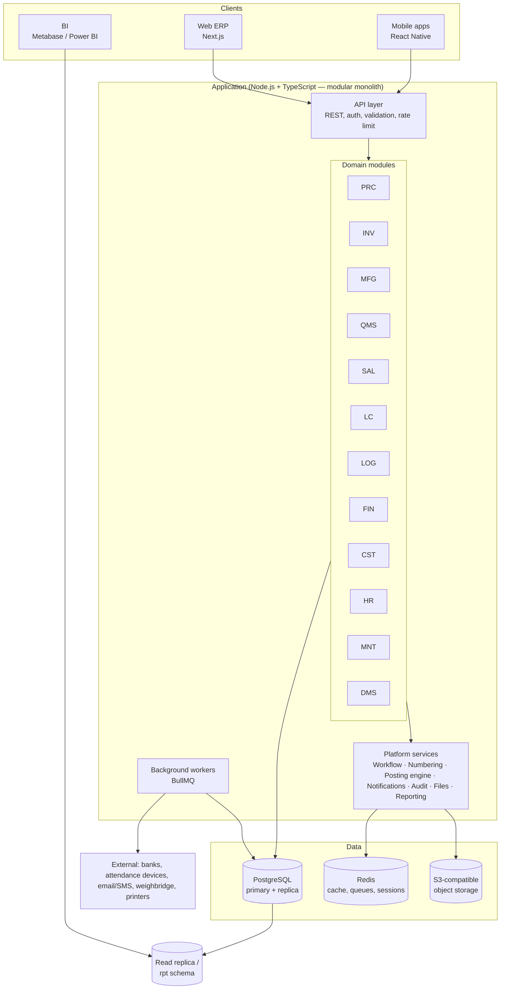
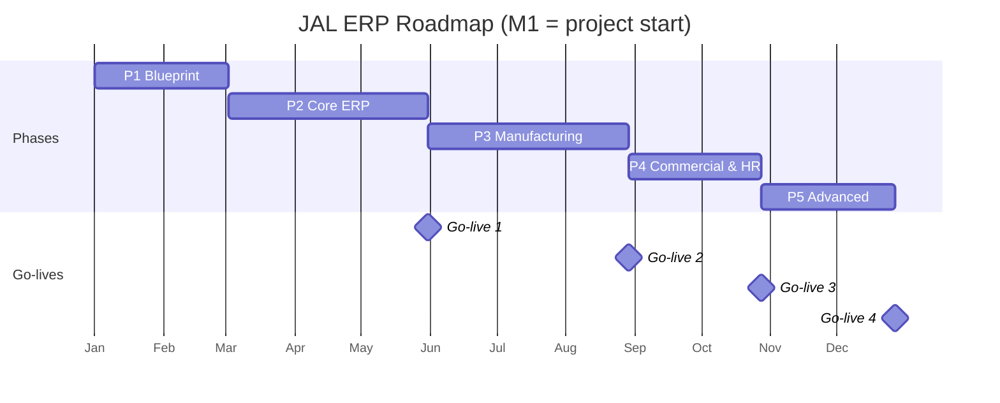

# JAL ERP — SRS Part 5

## Non-Functional Requirements, Architecture, Integration & Implementation

---

## 5.1 Non-Functional Requirements

### 5.1.1 Performance & Scalability

| ID | Requirement | Target |
|---|---|---|
| NFR-PER-001 | Screen load / form open (p95) | ≤ 2 s on factory LAN |
| NFR-PER-002 | Document save / submit (p95) | ≤ 1.5 s |
| NFR-PER-003 | List / search results, up to 1M rows in table (p95) | ≤ 2 s (paginated) |
| NFR-PER-004 | Standard operational reports (one month) | ≤ 10 s; heavier reports run as background jobs with notification |
| NFR-PER-005 | Payroll run for 2,800 employees | ≤ 15 min |
| NFR-PER-006 | MRP run (full) | ≤ 10 min |
| NFR-PER-007 | Month-end cost allocation & settlement | ≤ 30 min |
| NFR-PER-008 | Concurrent users | 150 concurrent, 400 named, without degradation; architecture scalable to 2× |
| NFR-PER-009 | Data growth | Sized for 10 years of transactions (est. stock ledger ~30M rows, attendance punches ~60M rows) via partitioning and archiving |

### 5.1.2 Availability, Backup & DR

| ID | Requirement | Target |
|---|---|---|
| NFR-AVL-001 | Availability (business hours, factory runs 24×7 in shifts) | 99.5% monthly, excluding planned maintenance |
| NFR-AVL-002 | Planned maintenance window | Weekly holiday, off-peak; announced 48 h ahead |
| NFR-AVL-003 | Backups | Nightly full + continuous WAL archiving; 30 daily, 12 monthly, 7 yearly retention; encrypted |
| NFR-AVL-004 | Recovery Point Objective (RPO) | ≤ 15 min |
| NFR-AVL-005 | Recovery Time Objective (RTO) | ≤ 4 h |
| NFR-AVL-006 | DR site | Secondary site / cloud region with streaming replica; DR drill twice a year |
| NFR-AVL-007 | Shop-floor offline tolerance | Mobile apps queue transactions for up to 8 h offline and sync with conflict detection |

### 5.1.3 Security

| ID | Requirement |
|---|---|
| NFR-SEC-001 | Authentication: username/password with strong policy; **MFA mandatory** for finance, HR/payroll, admin and remote access; SSO-ready (OIDC). |
| NFR-SEC-002 | Session timeout 30 min idle (configurable); concurrent session control. |
| NFR-SEC-003 | TLS 1.2+ for all traffic; data at rest encrypted (database volumes, backups, object storage). |
| NFR-SEC-004 | Sensitive fields (bank accounts, NID, salary) encrypted at column level or masked by permission. |
| NFR-SEC-005 | OWASP ASVS Level 2 controls; OWASP Top 10 addressed; annual third-party penetration test before go-live and yearly. |
| NFR-SEC-006 | Immutable audit log of logins, permission changes, master/transaction changes, exports and prints; retained ≥ 8 years. |
| NFR-SEC-007 | API access via OAuth2 client credentials / scoped tokens; rate-limited. |
| NFR-SEC-008 | Secrets in a vault/secret manager, never in source code. |
| NFR-SEC-009 | Dependency and container image vulnerability scanning in CI. |

### 5.1.4 Usability, Maintainability, Compliance

| ID | Requirement |
|---|---|
| NFR-USE-001 | A trained storekeeper completes a GRN in ≤ 2 min; a supervisor completes a shift entry in ≤ 3 min. |
| NFR-USE-002 | Contextual help and field tooltips; user manuals per role. |
| NFR-MNT-001 | Modular code structure with enforced module boundaries (no cross-module DB writes; see §5.2). |
| NFR-MNT-002 | Automated test coverage ≥ 70% on domain/service layer; critical posting/costing logic ≥ 90%. |
| NFR-MNT-003 | All configuration (thresholds, rates, formulas, workflows, templates) changeable without code deployment. |
| NFR-MNT-004 | Zero-downtime deployments for minor releases where possible; database migrations backward-compatible. |
| NFR-CMP-001 | Statutory records retained per Bangladesh law (accounting ≥ 6 years, payroll/labour records per Labour Act) — default retention 8 years. |
| NFR-CMP-002 | Personal data handled on least-privilege basis; export of personal data logged. |
| NFR-OBS-001 | Centralised logs, metrics and traces; dashboards and alerts in Grafana/Prometheus (CPU, memory, DB, queue backlog, error rate, slow queries). |

---

## 5.2 Technical Architecture

### 5.2.1 Logical Architecture



### 5.2.2 Technology Stack

| Layer | Choice | Notes |
|---|---|---|
| Web frontend | Next.js (React, TypeScript) | Component library (e.g. shadcn/ui or Ant Design) for data-dense ERP grids/forms; TanStack Query/Table |
| Mobile | React Native (Expo) | Shop floor, warehouse scanning, approvals, management dashboard; offline store (SQLite) |
| Backend | Node.js LTS + TypeScript, NestJS (recommended) | Module system maps to ERP modules; DI; guards for RBAC |
| ORM / SQL | Prisma or Kysely/Drizzle + raw SQL for heavy reports | Transactions wrap document posting + stock + GL |
| Database | PostgreSQL 16+ | Schemas per module; partitioning; RLS |
| Cache / queue | Redis + BullMQ | Payroll, MRP, costing runs, report generation, notifications, integrations |
| Files | S3-compatible (MinIO on-prem or cloud S3) | Attachments, generated PDFs |
| PDF | Headless Chromium (Playwright) HTML → PDF | Print templates |
| Reporting | Built-in reports + Metabase (embedded) or Power BI | Read replica, `rpt` views |
| Auth | Built-in auth (Argon2 hashes) + TOTP MFA, OIDC-ready | RBAC + data scopes |
| Observability | Prometheus, Grafana, Loki, OpenTelemetry | |
| CI/CD | Git + GitHub Actions/GitLab CI, Docker images | Environments: Dev, QA, UAT, Prod, DR |
| Deployment | Docker on VMware / private cloud (Kubernetes optional later) | Pending Q-12 |

### 5.2.3 Modular Monolith Rules

1. Each module owns its schema; only that module writes to it.
2. Modules interact through **public service interfaces** (in-process) and **domain events** (in-process event bus, persisted to an outbox table for reliable async handling).
3. Cross-module reads for reporting use read-only views in the `rpt` schema.
4. Shared kernel (`core`, `mdm`) contains organisation, items, UOM, parties, currencies.
5. Boundaries enforced by lint rules (e.g. dependency-cruiser) in CI.

**Key domain events:** `GrnPosted`, `QcDecisionMade`, `StockMoved`, `ProductionEntryPosted`, `ProductionOrderClosed`, `ContractApproved`, `BaleStuffed`, `ShipmentOnBoard`, `InvoicePosted`, `RealisationPosted`, `PayrollPosted`, `WorkOrderClosed`.

### 5.2.4 Posting Engine

All financial impact flows through a single **posting engine**:

```
Business event → Posting rule lookup (event type × item/party group × company)
              → Voucher lines with dimensions → Validate (balanced, period open, dimension rules)
              → Persist voucher + sub-ledger entries in the SAME DB transaction as the business document
```

Example rules:

| Event | Debit | Credit |
|---|---|---|
| Raw jute GRN | Inventory — Raw Jute | GRNI (GR/IR clearing) |
| Supplier bill | GRNI; Input VAT | Accounts Payable — Supplier |
| Issue raw jute to production | WIP — Batching | Inventory — Raw Jute |
| Stage output received | Inventory — Semi-finished (e.g. Yarn) | WIP — Stage |
| FG receipt | Inventory — Finished Goods | WIP — Packing |
| Shipment on board | Cost of Goods Sold; AR — Customer | Inventory — FG; Export Sales |
| Export realisation | Bank (FC); Bank charges; FX loss | AR — Customer; FX gain |
| Payroll | Wages expense (by cost centre) | Salaries payable; PF payable; TDS payable |
| Depreciation | Depreciation expense (by work centre) | Accumulated depreciation |

### 5.2.5 Suggested Repository Structure

```
jute-erp/
├─ apps/
│  ├─ api/                 # NestJS modular monolith
│  │  └─ src/modules/{core,mdm,prc,inv,mfg,qms,sal,lc,log,fin,cst,hr,mnt,dms,wf}/
│  ├─ web/                 # Next.js
│  ├─ mobile/              # React Native
│  └─ worker/              # BullMQ job processors (shares api modules)
├─ packages/
│  ├─ domain-types/        # shared TS types / DTOs / zod schemas
│  ├─ ui/                  # shared UI components
│  └─ config/              # eslint, tsconfig, boundary rules
├─ db/
│  ├─ migrations/
│  └─ seeds/               # masters, CoA, UOMs, roles
├─ docs/                   # SRS, ADRs, API docs
└─ infra/                  # docker, compose, k8s (optional), monitoring
```

### 5.2.6 API Conventions

| Topic | Convention |
|---|---|
| Style | REST, JSON, `/api/v1/<module>/<resource>` |
| Actions | Document state changes as sub-resources: `POST /api/v1/prc/purchase-orders/{id}/submit`, `/approve`, `/post`, `/cancel` |
| Idempotency | `Idempotency-Key` header required on create/post endpoints (mobile offline sync) |
| Concurrency | `If-Match` with record `version` (optimistic locking) |
| Pagination | Cursor-based; `limit` ≤ 200 |
| Errors | RFC 7807 problem+json with field-level validation errors |
| Docs | OpenAPI 3.1 generated from code |

---

## 5.3 Integration Requirements

| ID | Integration | Direction | Method | Pri | Phase |
|---|---|---|---|---|---|
| INT-001 | Biometric / RFID attendance devices | In | Vendor SDK/API or DB pull every 5–15 min; CSV fallback | M | P4 |
| INT-002 | Banks — salary/vendor payments | Out | Bank-specific file formats (BEFTN/RTGS CSV/XML); host-to-host API where bank supports | M | P2/P4 |
| INT-003 | Banks — statements | In | CSV / MT940 import for reconciliation | M | P2 |
| INT-004 | Mobile financial services (salary disbursement, if used) | Out | Bulk disbursement file / API | S | P4 |
| INT-005 | Weighbridge | In | Serial/TCP reader or vendor software DB/CSV | S | P2 |
| INT-006 | Barcode/QR label printers (Zebra etc.) | Out | ZPL templates via print server | M | P3 |
| INT-007 | Handheld scanners | In | Android app with built-in scanner SDK | S | P5 |
| INT-008 | Email (SMTP) and SMS gateway | Out | SMTP / SMS provider API | M | P2 |
| INT-009 | Exchange rates | In | Bank rate sheet import / API (daily) | S | P2 |
| INT-010 | BI tools | Out | Read replica, `rpt` views, service account | S | P5 |
| INT-011 | Power/energy meters | In | CSV import; Modbus/IoT gateway (future) | C | P5 |
| INT-012 | PLC/SCADA machine counters | In | Feasibility study (OPC UA/MQTT) | W | Future |
| INT-013 | Government VAT / customs systems | Out | Export of statutory formats; direct API future | C | Future |

Integration principles: all integrations run as background jobs with retry, dead-letter queue, monitoring dashboard and full payload logging (sensitive fields masked).

---

## 5.4 Data Migration

| Object | Source (to confirm, Q-14) | Approach | Phase |
|---|---|---|---|
| Chart of accounts | Existing accounting system / new design | Redesign with dimensions; mapping table old → new | P1 |
| Opening GL balances | Trial balance at cut-over date | Import as opening voucher; reconcile to audited TB | P2 |
| Suppliers, customers | Spreadsheets / accounting | Cleanse, de-duplicate, import via templates | P2 |
| Items & product specs | Product list (16 unique products) + store item lists | Structured attribute capture workshops | P1–P2 |
| Opening stock | Physical count at cut-over | Count → import by item/lot/location with value | P2 / P3 |
| Open POs, open contracts, open LCs | Department registers | Import open lines/balances | P2 / P4 |
| AR / AP open items | Accounting sub-ledgers | Import invoice-level open items, reconcile to control accounts | P2 |
| Fixed assets | Asset register | Import with cost, accumulated depreciation, remaining life | P2 |
| Employees | HR files / payroll system | Import master + YTD payroll + leave balances + loan balances | P4 |
| Machines | Maintenance records | Import register + PM schedules | P5 |

Each migration has: mapping spec, validation rules, trial loads (≥ 2), reconciliation sign-off by process owner.

---

## 5.5 Testing & Acceptance

| Level | Scope | Owner |
|---|---|---|
| Unit tests | Domain logic (deduction formula, UOM conversion, costing, payroll calc, posting rules) | Developers |
| Integration tests | Module flows within API with real PostgreSQL | Developers |
| End-to-end tests | Key journeys in web/mobile (Playwright / Detox) | QA |
| Performance tests | NFR-PER targets with production-like volumes (k6) | QA / DevOps |
| Security tests | SAST, dependency scan, DAST, penetration test | Security vendor |
| UAT | Scenario-based scripts per module, signed by process owners | JAL key users |
| Parallel run | Payroll: 1 cycle parallel; Finance: 1 month-end parallel | JAL Finance/HR |

**Key end-to-end UAT scenarios (minimum):**

1. Raw jute purchase: contract → gate → weighbridge → moisture deduction → GRN → bill → payment → GL.
2. MTO bag order: quotation → contract with customer stripe override → MPS → stage orders → shift entries → QC → bales → allocation.
3. Export: export LC → shipment booking → container stuffing by scan → packing list, commercial invoice, EXP → bank submission → realisation with FX gain/loss.
4. Rejected bale cannot be stuffed (BR-QMS-001).
5. Full traceability: from a shipped bale back to raw jute supplier lots.
6. Month-end: depreciation, FX revaluation, overhead allocation, order settlement, product cost sheet, P&L by product and customer.
7. Payroll: attendance import → OT → piece-rate from production → payroll → bank file → GL.
8. Breakdown: request from floor → work order → spare issue → downtime reflected in production efficiency and machine cost.

**Acceptance criteria for go-live (per phase):** all Must requirements of the phase pass UAT; no open Severity-1/2 defects; data migration reconciled and signed; users trained; cut-over rehearsal completed.

---

## 5.6 Training & Change Management

- Role-based training curriculum; train-the-trainer with ~30 key users.
- Sandbox environment with realistic data for practice.
- Bangla quick-reference guides for shop-floor and warehouse users.
- Hypercare: 4 weeks on-site support after each go-live.

---

## 5.7 Support Model (post go-live)

| Severity | Definition | Response | Resolution target |
|---|---|---|---|
| S1 | System down / production, shipment or payroll blocked | 30 min | 4 h |
| S2 | Major function impaired, workaround exists | 2 h | 1 business day |
| S3 | Minor issue | 1 business day | 5 business days |
| S4 | Enhancement / query | 2 business days | Planned release |

---

## 5.8 Implementation Roadmap

Aligned with the overview's 12-month plan. Phase codes P1–P5 are used throughout this SRS.

| Phase | Months | Deliverables | Go-live |
|---|---|---|---|
| **P1 — Blueprint** | 1–2 | Process workshops; answers to Q-01…Q-14; SRS v1.0 baseline; CoA; product master structure; UI prototypes; infrastructure setup; platform (auth, RBAC, workflow, numbering, audit) | — |
| **P2 — Core ERP** | 3–5 | Finance (GL, AP, AR, bank, FA, VAT), Procurement incl. raw jute, Inventory, Sales (customer, quotation, contract), DMS & workflow | **Go-live 1** (end M5) |
| **P3 — Manufacturing** | 6–8 | Product revisions, BOM, routing, MPS/MRP, production orders, shift entry, QMS, costing & budgeting, dashboards v1 | **Go-live 2** (end M8) |
| **P4 — Commercial & HR** | 9–10 | Export LC, B2B/import LC, logistics & shipment, EXP & realisation, HR, attendance, payroll | **Go-live 3** (end M10) |
| **P5 — Advanced** | 11–12 | CMMS, barcode/QR & handheld scanning, mobile apps, BI dashboards, Bangla self-service, DR drill | **Go-live 4** (end M12) |

> **Note:** The overview's §10 scope table lists Sales & Export as "Phase 1–2" and Maintenance as "Phase 3", while its roadmap places export/LC in Months 9–10 and maintenance in Months 11–12. This SRS follows the month-based roadmap: core sales (customer → contract) in P2, export documentation/LC in P4, CMMS in P5. Confirm in Phase 1.



*(Start date illustrative.)*

---

## 5.9 Effort Estimation (indicative)

Rough order of magnitude for a custom build; to be re-estimated after SRS v1.0 baseline.

| Work package | Person-months |
|---|---|
| Platform (auth, RBAC, workflow, numbering, audit, files, notifications, print engine) | 10 |
| Master data, product specs, UOM | 5 |
| Procurement incl. raw jute | 7 |
| Inventory & warehouse, traceability | 8 |
| Production planning & control | 12 |
| Quality management | 5 |
| Sales & export | 7 |
| Commercial & LC, logistics | 8 |
| Finance & accounting, posting engine | 12 |
| Costing & budgeting | 7 |
| HR, attendance & payroll | 10 |
| Maintenance (CMMS) | 5 |
| Dashboards, reports, BI | 7 |
| Mobile apps | 7 |
| Integrations | 5 |
| Data migration | 4 |
| QA, performance & security testing | 12 |
| Project management, BA, UX | 14 |
| **Total** | **≈ 145 person-months** |

**Suggested team (peak):** 1 project manager, 2 business analysts (manufacturing + finance/HR), 1 UX designer, 1 solution architect, 6–8 full-stack developers, 1 mobile developer, 3 QA engineers, 1 DevOps engineer — roughly 15–17 people over 12 months, plus JAL key users (~30, part-time).

---

## 5.10 Risks & Mitigations

| # | Risk | Impact | Mitigation |
|---|---|---|---|
| R-01 | Business questions (Q-01…Q-14) unanswered or late | Rework, delay | Fix P1 decision deadlines; steering committee sign-off |
| R-02 | Factory process variation vs. assumed routing | Wrong BOM/costing | Floor walk-throughs per stage; pilot one product line first |
| R-03 | Poor master data quality (items, specs, suppliers) | Bad transactions, wrong stock | Dedicated data cleansing team in P1–P2 |
| R-04 | Shop-floor adoption (data entry discipline) | Missing production/waste data | Simple tablet screens, supervisor KPIs tied to data completeness, Bangla UI |
| R-05 | Costing complexity / disagreement on allocation basis | Mistrusted profitability numbers | Agree costing policy document with CFO in P1; parallel run vs. manual costing |
| R-06 | Payroll errors at go-live | Labour unrest | Parallel payroll run; worker-category pilot |
| R-07 | Network/power reliability on factory floor | Lost entries | Offline-capable mobile apps; UPS; Wi-Fi survey |
| R-08 | Scope creep | Schedule overrun | Change control board; MoSCoW enforced |
| R-09 | Key-user availability during peak season | UAT delays | Back-fill plan; schedule UAT outside peak jute purchase season |
| R-10 | Regulatory changes (VAT, Bangladesh Bank rules, wages) | Non-compliance | All rates/rules configurable; compliance review each release |

---

## 5.11 Sign-off

| Role | Name | Signature | Date |
|---|---|---|---|
| JAL — Managing Director / CEO | | | |
| JAL — CFO | | | |
| JAL — Factory Head | | | |
| JAL — Commercial Head | | | |
| JAL — HR Head | | | |
| Samuda Chemical Complex — Oversight representative | | | |
| ERP Project Manager | | | |
| Solution Architect | | | |
