# JAL ERP — Production User Guide with Sample Use Cases

**Prototype v0.1** · Screens captured from the web app (`jal-erp-web`, http://localhost:5173) on 5–6 Nov 2026.
All figures are from the prototype's demo data — BOM quantities, stock and waste percentages are planning estimates, not JAL's actual numbers.

This guide walks through three real-life jobs from start to finish:

| # | Use case | Product | Quantity | Route | What it shows |
|---|---|---|---|---|---|
| **1** | Export order, make-to-order | Standard B' Twill Sacking Bag | 19,500 bags = 65 bales = one 20′ FCL | 11 stages | MRP with stock netting, releasing an order, a rejected entry, posting batching and sewing shifts |
| **2** | Export order, make-to-order | Hessian Cloth 40″ 10 oz | 64,000 yd = 32 bales = one 20′ FCL | 9 stages (no cutting/sewing) | Output in **yards**, input in kg; a loom breakdown |
| **3** | Stock replenishment, make-to-stock | 28/1 Jute Yarn Cops | 50,000 cops = 100 bales | 7 stages (stops at winding) | No contract, output in **pieces**, complete and close an order |

The same five steps apply to every product:

```
① Check BOM & routing  →  ② Run MRP  →  ③ Release the stage order  →  ④ Post a shift entry each shift  →  ⑤ Complete & close
                                                                                  │
                                                                     Daily board · Process view · Dashboard
```

---

## Part A — Getting started

### A1. Sign in

Open the app. The left panel shows the company; the right panel is the sign-in form.

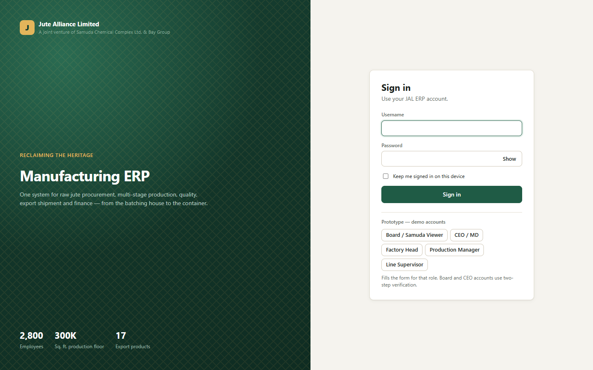

1. Enter your **username** and **password**. In the prototype, the buttons under *Prototype — demo accounts* fill them in for each role.
2. Click **Sign in**. Board and CEO accounts are asked for a 6-digit verification code (demo code `246810`).


| Role | Use it for |
|---|---|
| Production Manager / Factory Head | BOMs, routings, MRP, creating / releasing / closing orders, shift entries |
| Line Supervisor | Shift entries only (no dashboard, no order release) |
| CEO / Board | Viewing only |

### A2. Home screen

The Production Manager lands on the **Executive Dashboard**. The sidebar has two groups you will use: **Manufacturing** (process, orders, shift entry, daily board) and **Engineering & planning** (Items & BOM, Routings, MRP explosion).

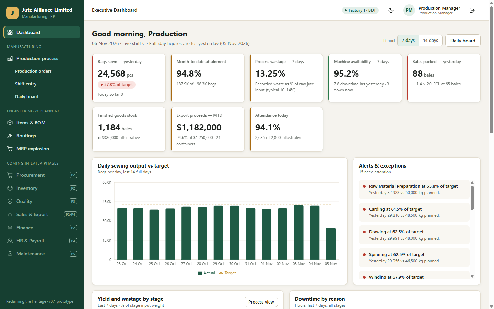

---

## Part B — Use case 1: Standard B' Twill sacking bags for export

> **Situation:** Contract **SC/JAL/2627/0023** from **CUST-EG-001 (Egypt)** for **19,500 Standard B' Twill bags** (44″ × 26.5″, 1,020 g, 6 × 8, 3 blue stripes), packed 300 bags per bale, 65 bales in one 20′ container, ship by **27 Nov 2026**.

### Step 1 — Check the BOM (*Engineering & planning → Items & BOM*)

Select the product in **BOM explorer**. The tree shows everything that goes into **one bale**, level by level, down to raw jute by grade.

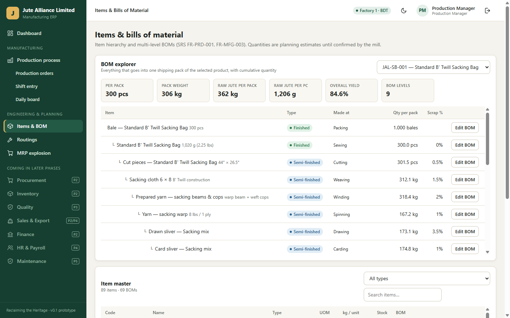

Read the six figures at the top:

- **Per pack** 300 pcs, **pack weight** 306 kg.
- **Raw jute per pack** 362 kg → **1,206 g raw jute per bag** → **overall yield 84.6%**.
- **9 BOM levels**: bale ← bags ← cut pieces ← cloth 6×8 ← prepared yarn ← warp / weft yarn ← drawn sliver ← card sliver ← batched jute ← raw jute Tossa B + White C.

If a quantity or waste % is wrong, click **Edit BOM** on that line, correct *Net qty* or *Scrap %*, and **Save BOM**.

### Step 2 — Check the routing (*Engineering & planning → Routings*)

The routing lists the 12 operations in order, the work centre for each, the item produced, planning days and QC points.

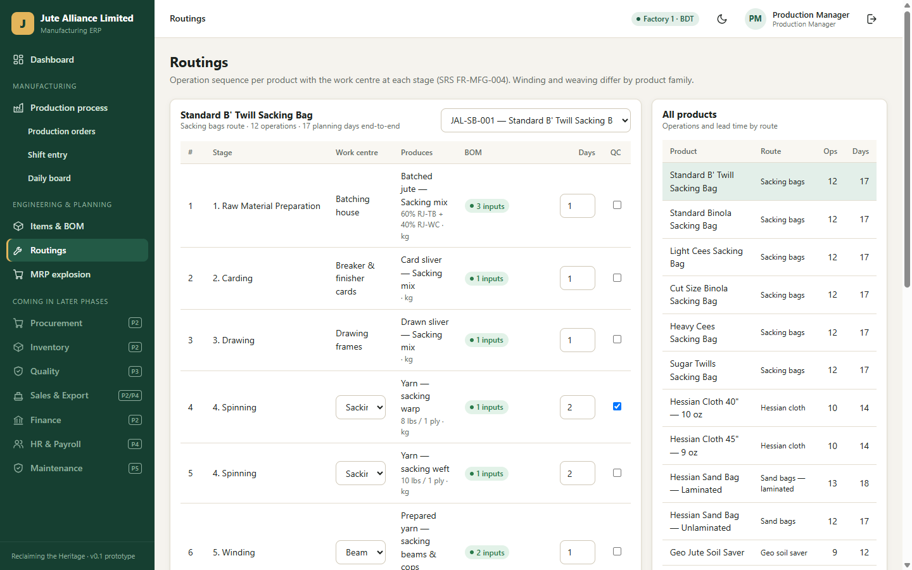

Check especially the stages where the work centre differs by product: **Spinning** = *sacking spinning frames (coarse counts)*, **Winding** = *beaming & weft cop winding*, **Weaving** = *sacking looms*. Click **Save routing** if you change anything.

### Step 3 — Run MRP for the contract (*Engineering & planning → MRP explosion*)

Fill in the contract line:

| Field | Value |
|---|---|
| Product | JAL-SB-001 — Standard B' Twill Sacking Bag |
| Quantity (pcs) | 19500 (hint shows *300 per bale · 19,500 per 20′ FCL*) |
| Ship by | 27 Nov 2026 |
| Sales contract | SC/JAL/2627/0023 |
| Customer | CUST-EG-001 (Egypt) |

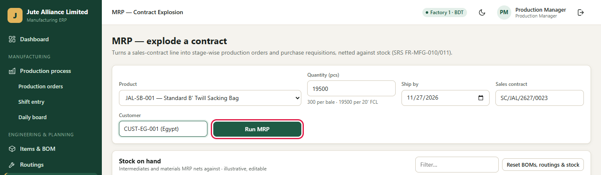

Click **Run MRP**.

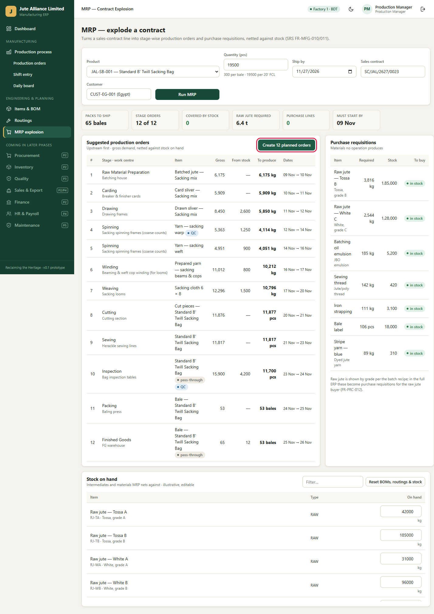

**How to read the result**

- **Packs to ship 65 bales · 12 stage orders · raw jute 6.4 t · must start by 09 Nov.**
- The table is read **bottom-up** (from the container back to raw jute):
  - *Finished Goods*: 65 bales needed, **12 bales already in stock** → 53 to make.
  - *Inspection*: 15,900 bags needed, **4,200 loose bags in stock** → 11,700 to pass.
  - *Sewing* 11,817 bags → *Cutting* 11,877 pieces → *Weaving* 10,796 kg cloth (1,500 kg already woven) → *Winding* 10,212 kg → *Spinning* 4,114 kg warp + 4,051 kg weft → *Drawing* 5,850 kg → *Carding* 5,909 kg → *Batching* 6,175 kg.
- **Gross** = what the next stage needs, **From stock** = covered by stock on hand, **To produce** = size of the production order. Dates are scheduled backwards from the ship-by date.
- **Purchase requisitions** (right): 3,816 kg Tossa B and 2,544 kg White C raw jute, oil, thread, strapping, labels, blue stripe yarn — all *in stock* in this example.

Click **Create 12 planned orders** (highlighted).

### Step 4 — See the planned orders (*Manufacturing → Production orders*)

Filter **Status = Planned** and search the contract number. One order per stage, all tagged *SC/JAL/2627/0023*, with "MRP: item at work centre" as the remark.

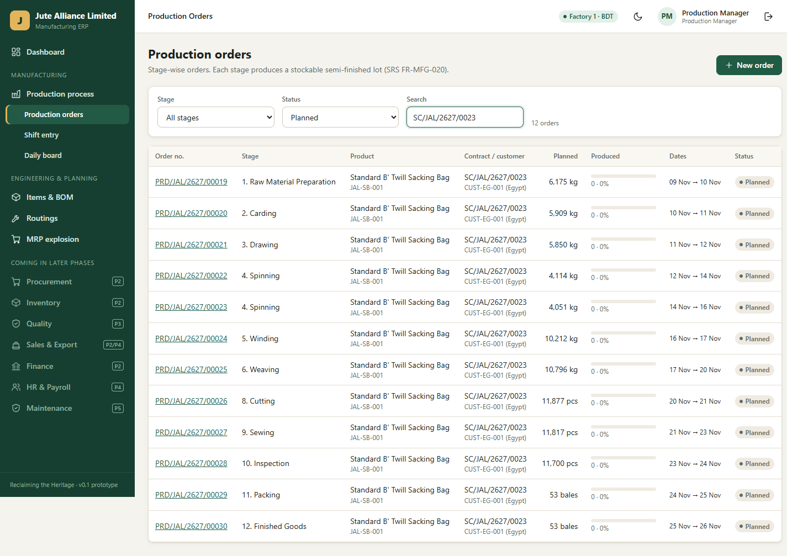

### Step 5 — Release the first stage

Open the **Raw Material Preparation** order. Status is **Planned**; the page shows the route, the specification from the customer list and the packing plan. Click **Release** when raw jute and the batching house are ready.

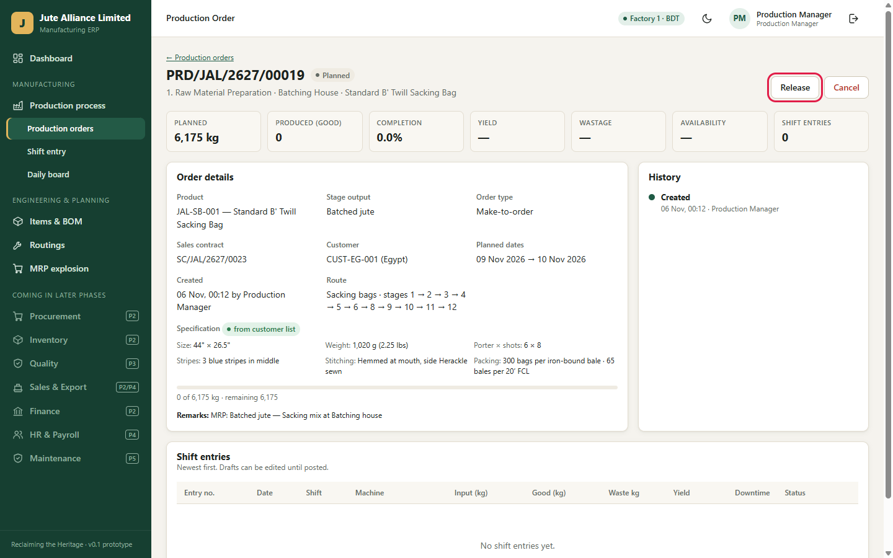

Status changes to **Released** and **Add shift entry** appears.

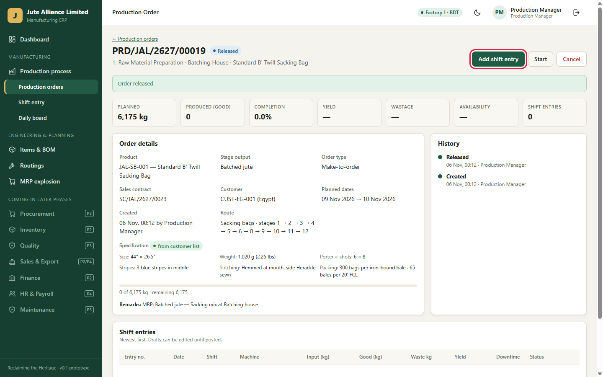

### Step 6 — Record the batching shift (*Shift entry*)

Click **Add shift entry** (or *Manufacturing → Shift entry* and pick the order). Date and shift default to the shift running now — shift C (22:00–06:00) belongs to the date it **starts**.

**A wrong entry is stopped.** The supervisor first typed a good output of 2,240 kg from 2,100 kg input. The live check shows yield 106.7% and a red message — output plus waste cannot exceed input by more than 2% — and **Post entry** is refused.

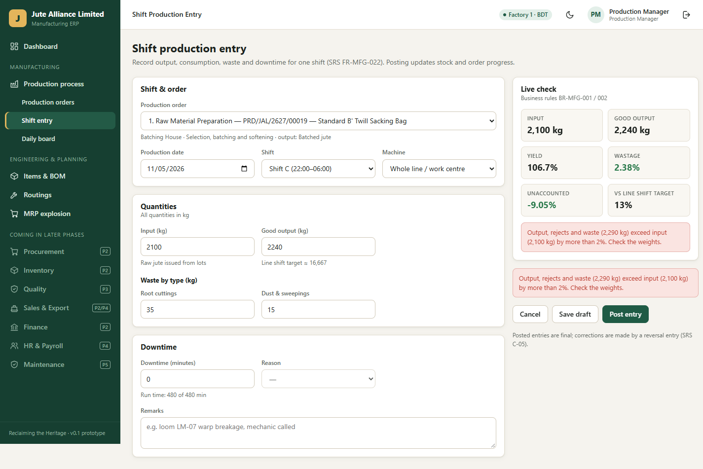

**Corrected entry:**

| Field | Value |
|---|---|
| Input (kg) | 2,100 — raw jute issued |
| Good output (kg) | 2,040 — batched jute |
| Root cuttings / Dust & sweepings | 35 kg / 15 kg |
| Downtime | 20 min — *Changeover* |
| Remarks | Recipe change from hessian mix to sacking mix at 10:30 |

Live check: **yield 97.1%, wastage 2.38%, unaccounted 0.48%** — all green. Click **Post entry**.

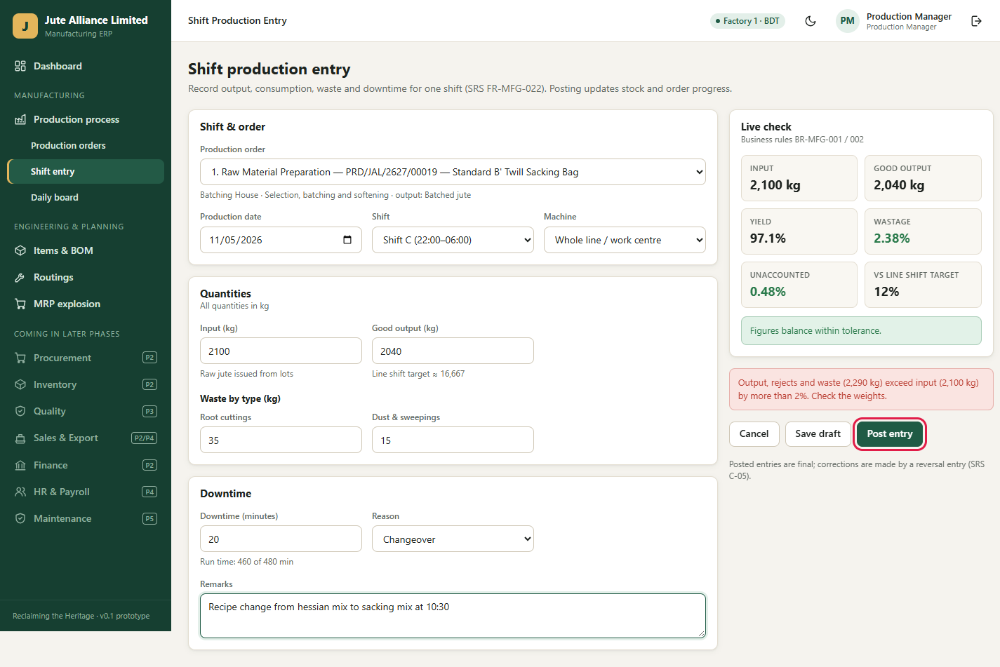

### Step 7 — Order progress

The order moves to **In progress** automatically. Produced, completion %, yield, wastage and availability are calculated from the posted entry; the history shows *Started (first shift entry posted)*.

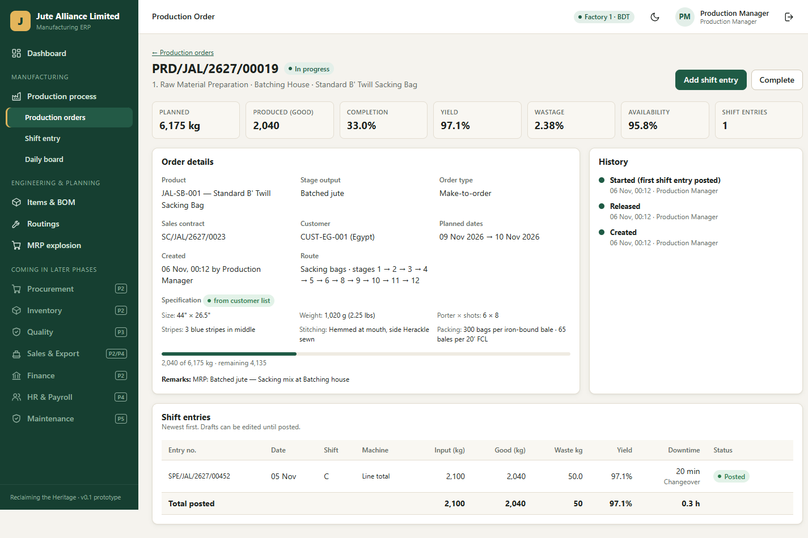

### Step 8 — The same for later stages — example: Sewing

Each later stage is released and recorded the same way. Sewing is a **count** stage (pieces) and records **rejects** separately:

| Field | Value |
|---|---|
| Input (pcs) | 3,950 cut pieces |
| Good output (pcs) | 3,905 bags |
| Rejected (pcs) | 30 — sent to rework or scrap |
| Thread waste | 6 kg |
| Downtime | 15 min — *No material* |

The system converts pieces to kg using the bag weight (**1.020 kg per bag**): yield 98.9%, rejects 0.76%, wastage 0.15%, unaccounted 0.23%.

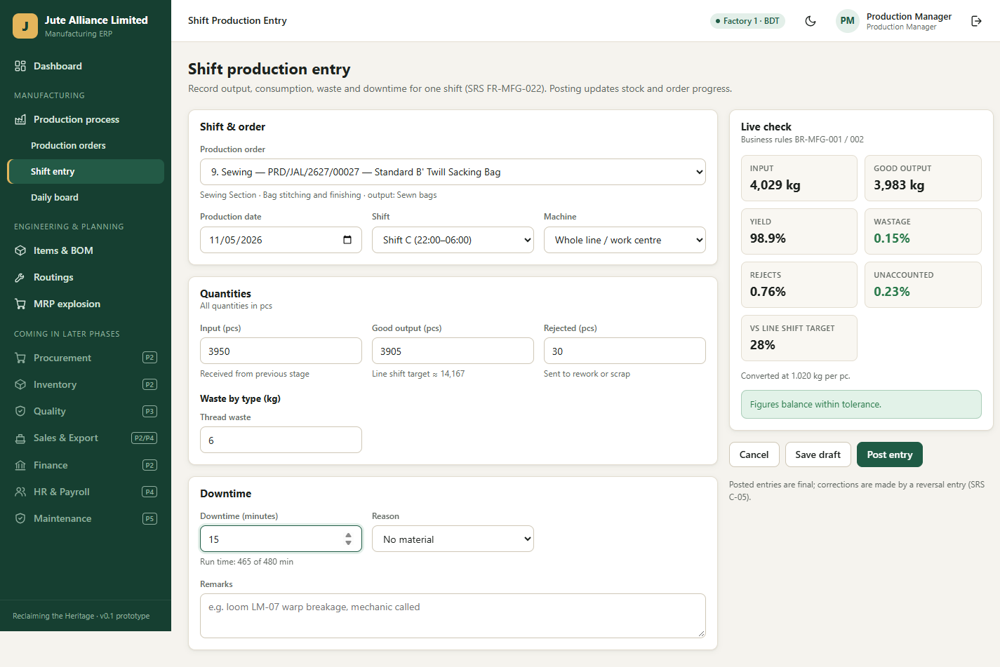

Continue shift by shift through Cutting, Inspection, Packing and Finished Goods until the 65 bales are in the FG warehouse, completing and closing each stage order as it finishes (see Use case 3, Step 5).

---

## Part C — Use case 2: Hessian cloth 40″ for export

> **Situation:** Contract **SC/JAL/2627/0024** from **CUST-BE-002 (Belgium)** for **64,000 yd Hessian Cloth 40″, 10 oz, 11 × 12**, packed 2,000 yd per bale, 32 bales per 20′ FCL, ship by 27 Nov 2026.

### Step 1 — Run MRP

Product **JAL-HC-001**, quantity **64000** (the unit switches to *yd*), contract and customer as above → **Run MRP**.

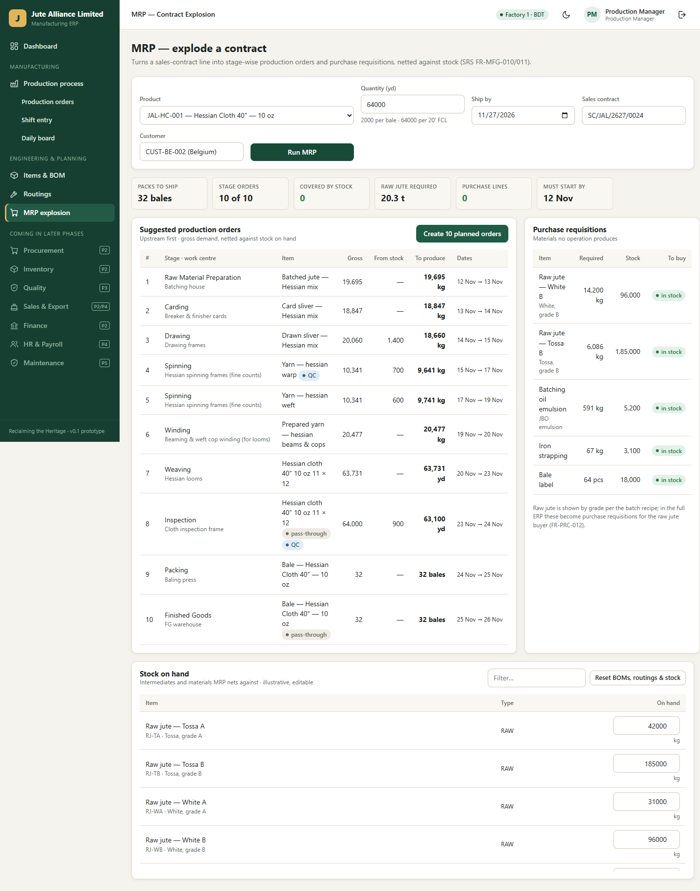

What is different from bags:

- **10 stage orders** — the hessian route has **no Cutting and no Sewing**; cloth goes from the loom to inspection and straight to baling.
- The spinning work centre is **Hessian spinning frames (fine counts)** and the loom is **Hessian looms**.
- **Weaving** and **Inspection** are planned in **yards** (63,731 yd and 63,100 yd), upstream stages in kg.
- Raw jute **20.3 t** from the *hessian mix* recipe (14,200 kg White B + 6,086 kg Tossa B).

Click **Create 10 planned orders**.

### Step 2 — Open and release the weaving order

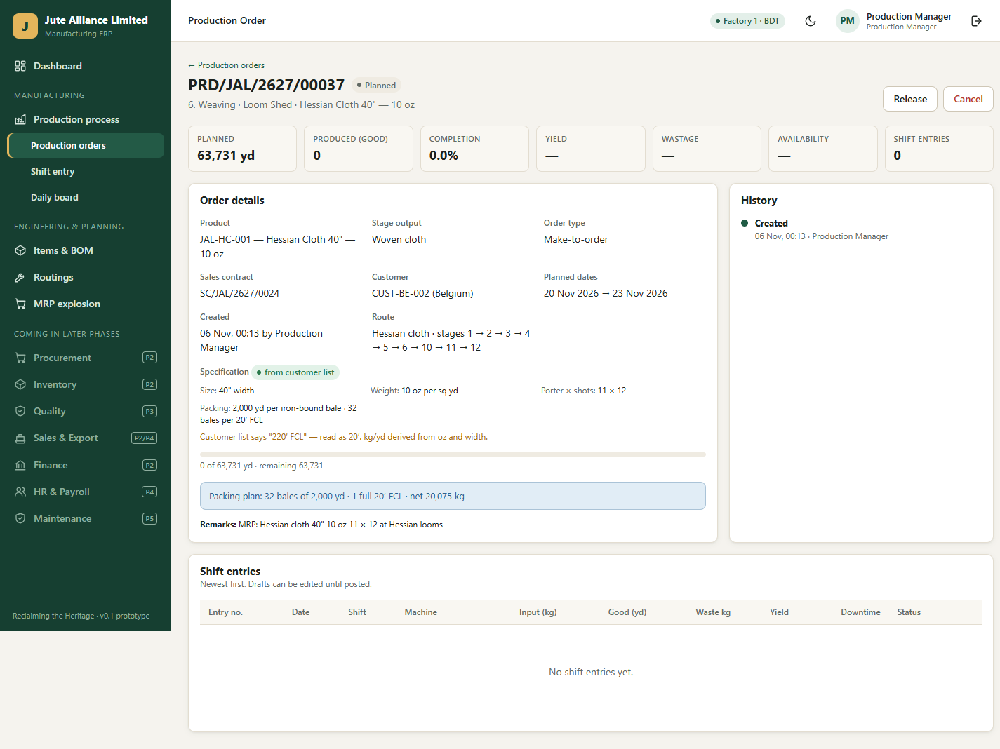

The order shows **Planned 63,731 yd**, the route *Hessian cloth · stages 1 → 2 → 3 → 4 → 5 → 6 → 10 → 11 → 12*, the specification (40″ width, 10 oz per sq yd, 11 × 12) and the packing plan *32 bales of 2,000 yd · 1 full 20′ FCL*. The amber note flags an assumption (the customer list said "220′ FCL", read as 20′). Click **Release**.

### Step 3 — Record a loom shift with a breakdown

| Field | Value |
|---|---|
| Input (kg) | 4,900 — prepared yarn on beams and weft cops |
| Good output (**yd**) | 15,200 yd of cloth |
| Thread waste / Selvedge waste | 62 kg / 25 kg |
| Downtime | 35 min — *Breakdown* |
| Remarks | Loom LM-07 warp beam bearing replaced |

The live check converts yards to kilograms at **315 g per yard** (10 oz × 40″) → 4,788 kg cloth: **yield 97.7%, wastage 1.78%, unaccounted 0.51%**. Click **Post entry**.

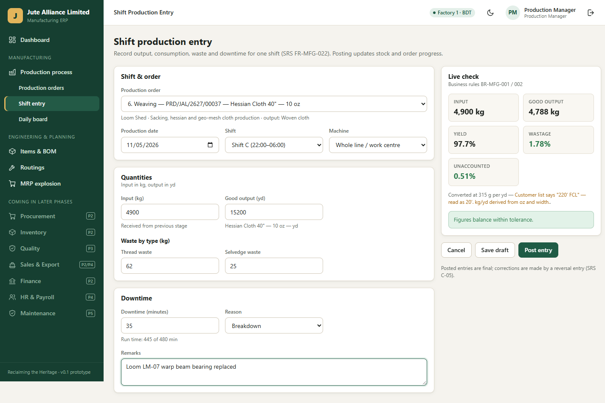

### Step 4 — Order progress

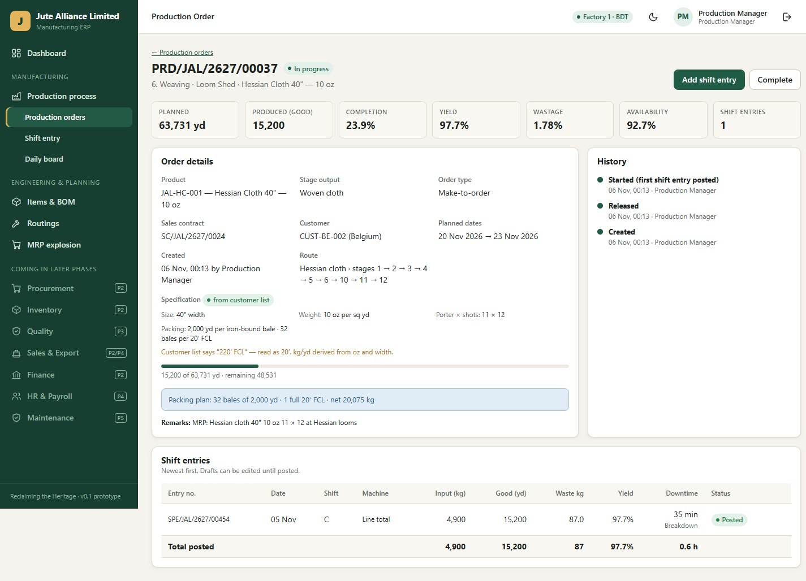

The breakdown minutes reduce **availability**, and the 35 min appear on the Daily board and in the Dashboard's *Downtime by reason* chart.

---

## Part D — Use case 3: 28/1 yarn cops for stock

> **Situation:** No customer order. The mill wants **50,000 cops of 28/1 jute yarn** (≈215 g each, 500 cops per bale) in stock for upcoming orders.

### Step 1 — Check which stages cops use (*Manufacturing → Production process*)

Scroll to **Product routes**. Each row is a route family; a filled square means the product passes that stage. **Yarn cops** use stages 1–5, then Packing and Finished Goods — no weaving, cutting or sewing.

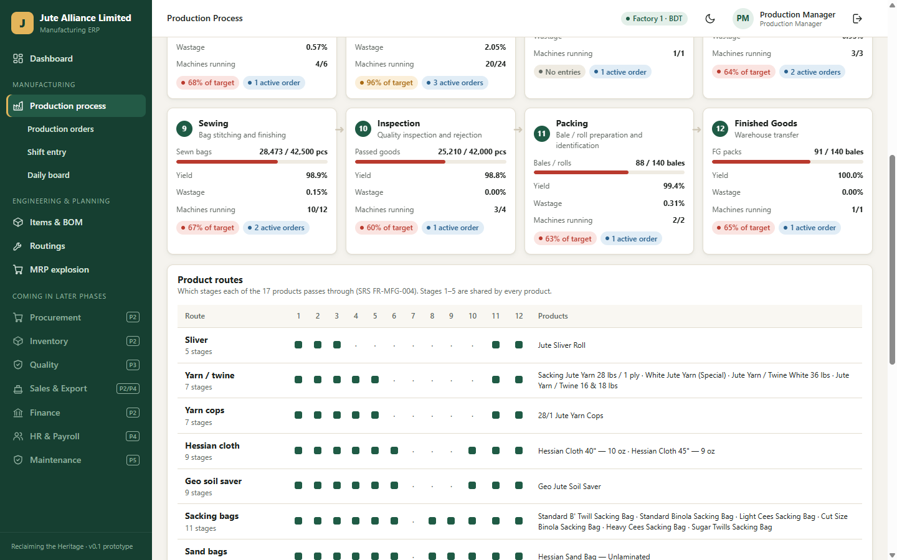

### Step 2 — Run MRP without a contract

Product **JAL-COP-001**, quantity **50000** (pcs), **leave Sales contract blank** → make-to-stock → **Run MRP**.

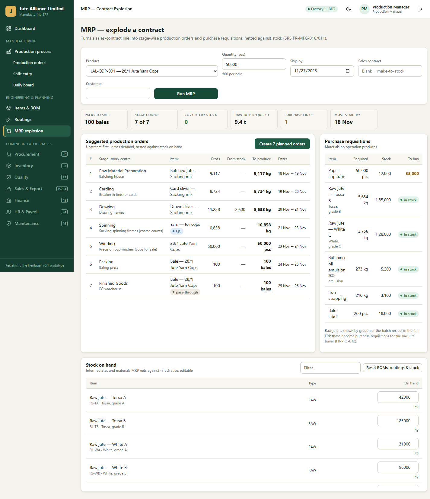

- **7 stage orders**; Winding is on **Precision cop winders (cops for sale)** and produces 50,000 pcs.
- Raw jute **9.4 t**.
- **Purchase line:** 50,000 paper cop tubes needed, 12,000 in stock → **38,000 to buy** (shown in amber). In the full ERP this becomes a purchase requisition.

Click **Create 7 planned orders**.

### Step 3 — Release and record the winding shift

Open the **Winding** order, **Release**, then enter the shift:

| Field | Value |
|---|---|
| Input (kg) | 2,200 kg yarn |
| Good output (**pcs**) | 10,100 cops |
| Thread waste | 14 kg |

Live check at **215 g per cop**: 2,172 kg → **yield 98.7%, wastage 0.64%**. The amber note reminds that *500 cops per bale* is an assumption not in the customer list. **Post entry.**

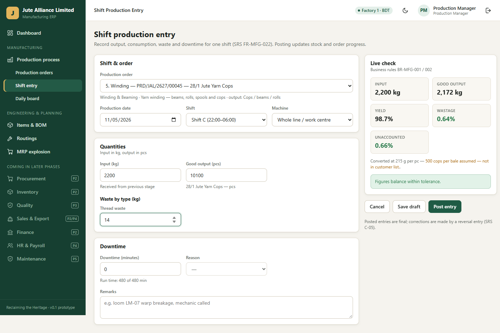

### Step 4 — Complete the order

When the run is finished (here: stopped early at 10,100 cops), click **Complete**. If any shift entry is still a *draft*, the system refuses and asks you to post or delete it first.

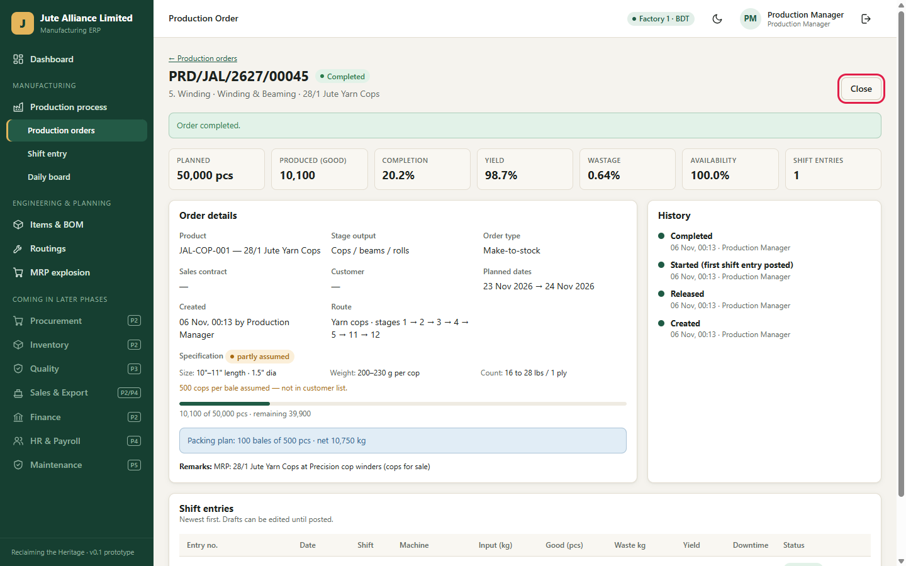

### Step 5 — Close the order

Click **Close** (highlighted). The order is now frozen: no more entries, final yield and wastage recorded, and the full history kept.

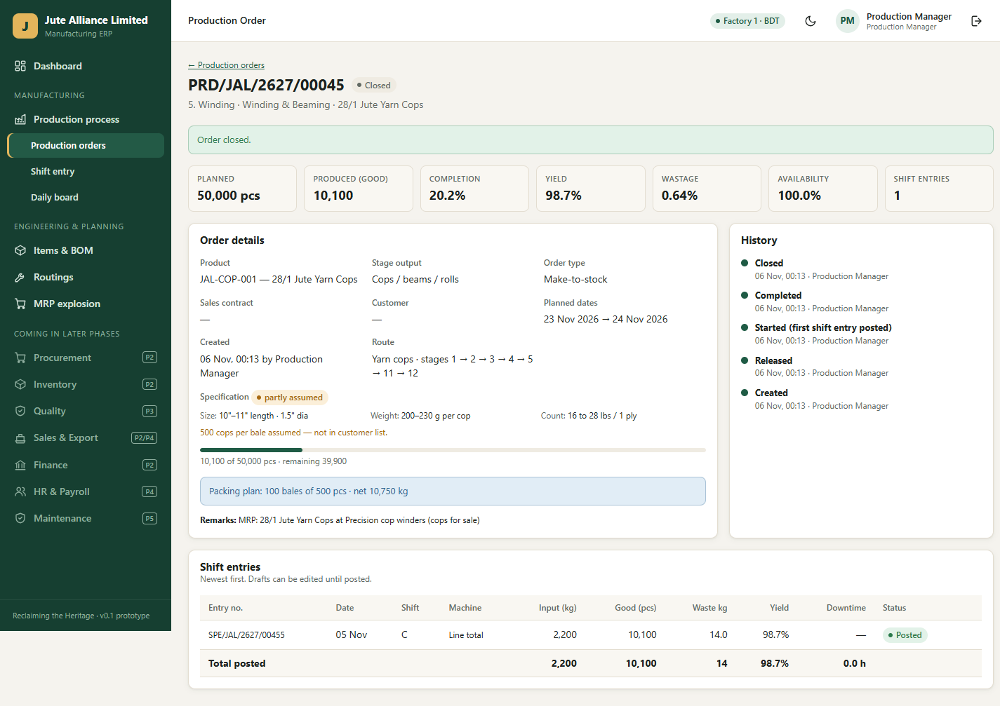

---

## Part E — Monitoring the floor

### E1. Daily production board (*Manufacturing → Daily board*)

One row per stage: target per shift, output in shifts A / B / C, day total, attainment, yield, wastage and downtime. The shift running now shows **Running**. Red/amber figures are below 90% / 98% of target. Below it, the machine map (green running, amber idle, red down) and the stoppages list. Use ← → to move between days.

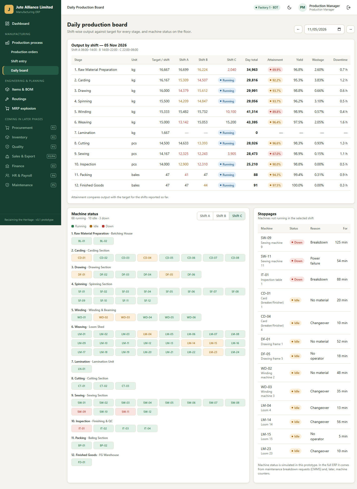

### E2. Production process (*Manufacturing → Production process*)

Twelve stage cards for the selected date with output vs target, yield, wastage, machines running and active orders. Click a card to list that stage's orders.

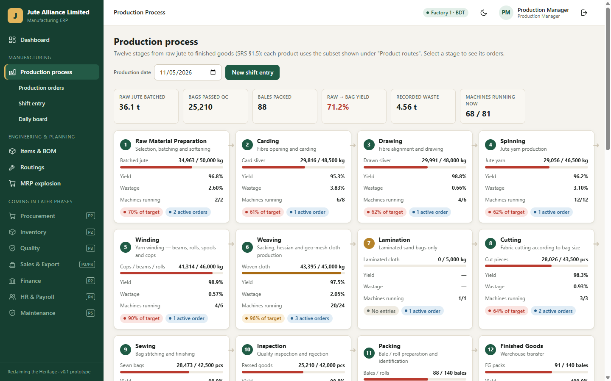

### E3. Executive dashboard

For management: bags sewn yesterday vs target, month-to-date attainment, process wastage, machine availability, bales packed, alerts, 14-day output chart, yield/wastage by stage, downtime by reason, export order book.

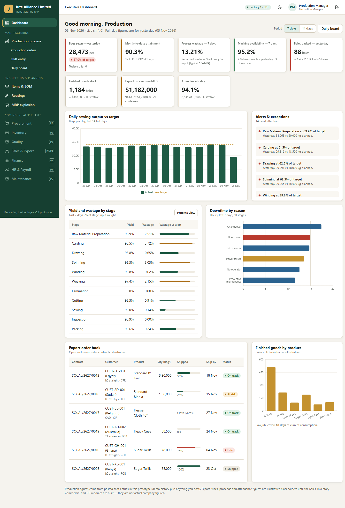

### E4. What the Line Supervisor sees

The supervisor has no Dashboard in the menu and lands on the Production process page, with a **New shift entry** button. They can open Items & BOM, Routings and MRP to look, but cannot edit BOMs or routings or create orders, and they cannot release, complete or close orders.

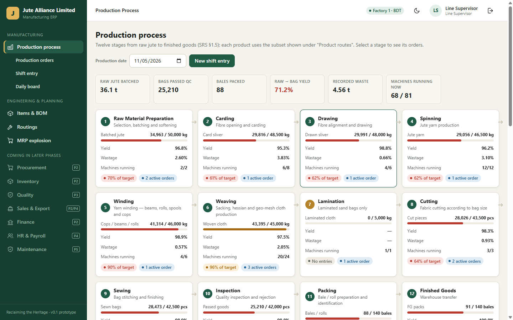

---

## Part F — Quick reference

**Order status**

```
Planned ──Release──► Released ──(first entry posted)──► In progress ──Complete──► Completed ──Close──► Closed
   └───────────Cancel───────────┘
```

**Units by product family**

| Family | Input → Output units at the key stage | Conversion used |
|---|---|---|
| Sacking bags, sand bags | Cutting kg → pcs; Sewing pcs → pcs; Packing pcs → bales | Bag weight (B' Twill 1,020 g, Binola 907 g, Cut Size Binola 790 g, Sugar Twills 1,134 g…) and bags per bale (300 or 400) |
| Hessian cloth | Weaving kg → yd; Packing yd → bales | 40″ 10 oz = 315 g/yd; 45″ 9 oz = 319 g/yd; 2,000 or 1,000 yd per bale |
| Geo soil saver | Weaving kg → yd; Packing yd → rolls | 553 g/yd; 75 yd per roll |
| Yarn / twine | Winding kg → kg; Packing kg → rolls | 50 kg per roll *(assumed)* |
| Yarn cops | Winding kg → pcs; Packing pcs → bales | 215 g per cop; 500 cops per bale *(assumed)* |
| Sliver | Packing kg → rolls | ≈13 kg per roll |

**Live check colours**

| Figure | Green | Red / amber |
|---|---|---|
| Wastage | below stage alert level | above alert (batching 3%, carding 4%, spinning 3.5%, weaving 2.5%, cutting 2%, sewing 0.8%…) |
| Unaccounted | below 3% | above 3% → waste was not weighed or input mis-recorded |
| Red message | — | **cannot post**: output + waste > input + 2%, duplicate shift, missing downtime reason, future date |

**Common questions**

- *Which date for night shift?* Shift C (22:00–06:00) belongs to the date it starts.
- *I posted a wrong figure.* Posted entries cannot be edited. In the full ERP you make a reversal entry; in the prototype, ask the Production Manager. Use **Save draft** if you are not sure.
- *The order is not in the shift entry list.* It must be **Released** or **In progress**. Ask the Production Manager to release it.
- *Why does MRP suggest fewer orders than stages?* Stages fully covered by stock are shown greyed as "covered" and no order is created.

## Part G — Limits of the prototype seen in these use cases

- **Stock is not reduced by MRP runs.** Use cases 1 and 3 both took 2,600 kg drawn sliver from stock; the full ERP reserves stock per contract.
- **No stage sequencing check.** Sewing could be posted before cutting had produced anything; the full ERP issues material from the previous stage's lots.
- **No lot tracking** of which raw-jute lot went into which bale (planned in SRS FR-INV-013).
- Machine status, export orders, FG stock, attendance and all BOM quantities are illustrative.
